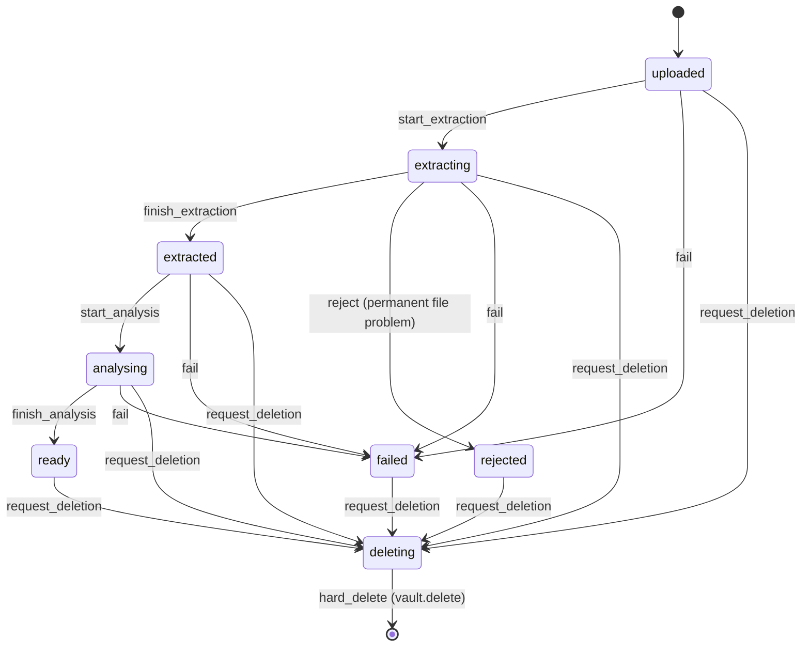
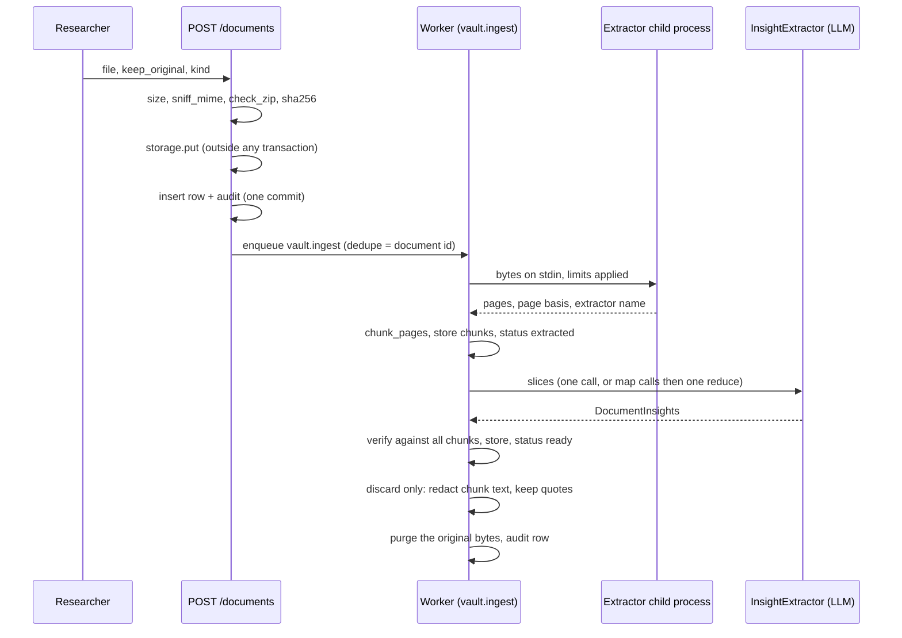

# vault — bounded context

**Purpose:** the researcher's private documents: upload (PDF or DOCX), text extraction, chunking with page offsets, structured insights checked against the text, the retention policy (D6, ADR-009) and deletion with a full cascade (ARCHITECTURE §3.2).
**Key aggregates:** `Document` (status machine, retention, kind), `StoredInsights` (every LLM item with its verification result).
**Design and decisions:** `docs/design/M2-vault-ingestion.md`; `docs/DECISIONS.md` 41 to 52.

**Status:** M2 implemented. Upload, ingestion job, the three retention policies, insight verification, deletion through `vault.delete`, and the `vault.sweep` recovery job. Not yet: retry for failed files (BACKLOG), switching a kept document to `discard` (BACKLOG), OCR for scanned PDFs (BACKLOG, see docling), citing vault evidence from opportunities (M3 and M4), and using the vault in matching (M5).

**Layout** (same for every context):

| Folder | Holds |
|---|---|
| `domain/` | Pure Python and Pydantic, stdlib only. See the list below. |
| `application/` | Use cases. Imports `domain` and `ports` only. |
| `ports/` | `TextExtractionPort`, `InsightExtractorPort`, the repositories and `VaultUnitOfWork`. |
| `adapters/` | `PdfDocxExtractor` (with the child process), `AgentsInsightExtractor`, `SqlVaultUnitOfWork`. |

Outside this folder, the vault uses the shared ports and adapters: `scout/ports/storage.py` (`FileStoragePort`), `scout/adapters/storage/local.py` and `supabase.py`, `scout/adapters/llm/factory.py` (`AgentFactory`), `scout/api/vault.py` (the five `/documents` endpoints) and `backend/migrations/versions/20261020_0004_vault.py`.

The import rules are enforced by import-linter (`make contracts`). The domain does not import pypdf, python-docx, pdfplumber or the LLM.

## Domain model

| Module | Contents |
|---|---|
| `domain/document.py` | `Document` aggregate: fields, transitions, `effective_kind` (the user's kind, else Scout's suggestion), `original_available`, `needs_purge`. Events: `DocumentUploaded`, `DocumentReady`, `DocumentRejected`, `OriginalDiscarded`, `DocumentDeleted` (ids only). |
| `domain/enums.py` | `DocKind`, `DocumentMime`, `DocStatus`, `RetentionPolicy` (deployment setting), `Retention` (per document), `PageBasis`. |
| `domain/ids.py` | `DocumentId`, `ChunkId`; `chunk_id(doc, ord)` is `uuid5`, so re-runs give the same ids; `storage_key(owner, doc)` is `vault/{owner}/{document}`. |
| `domain/upload.py` | `sniff_mime` (magic bytes only), `check_zip` (zip-bomb limits), `clean_filename`, `resolve_retention`. Errors: `FileTooLarge` (413), `UnsupportedFileType` (415), `FileRejected` (422). |
| `domain/chunking.py` | `chunk_pages`, `ChunkParams` (target 3000, max 4000, min 600 characters). |
| `domain/slicing.py` | `plan_slices`: one slice up to 120k characters, then greedy slices of 60k. |
| `domain/insights.py` | `DocumentInsights` (LLM output, matches `prompts/InsightExtractor.md`), `InsightItem`, `StoredInsights`, `Section`, `ItemStatus`, `UnverifiedReason`, `Stage`. |
| `domain/verification.py` | `verify` and `norm` (the rules are below). |
| `domain/retention.py` | `retained_content`: the quotes and summaries a discarded document keeps (at most 300 characters each). |

## State machine

`Document` moves only along these edges. Anything else raises `InvalidStateTransition`.



| Transition | From | Also |
|---|---|---|
| `start_extraction` | `uploaded`, `extracting` | Re-running after a crash is allowed. |
| `finish_extraction` | `extracting` | Sets pages, page basis, chunk count and extractor. |
| `reject(code)` | `extracting` | Terminal. Records the code and an event. |
| `start_analysis` | `extracted`, `analysing` | Re-running is allowed. |
| `finish_analysis` | `analysing` | Sets `ready`, `kind_suggested` and `kind_reason`. |
| `fail(code)` | `uploaded`, `extracting`, `extracted`, `analysing` | Only after the last job attempt, or from the sweeper. |
| `mark_original_deleted` | `ready`, `failed`, `rejected`, and only for `discard` | Idempotent. Returns True the first time. |
| `set_kind` | any except `deleting` | The user's choice overrides the suggestion. |
| `request_deletion` | any except `deleting` | Idempotent. Returns False when already deleting. |

`ready`, `failed` and `rejected` never go back to an in-progress status. `deleting` is final. The state machine is table-tested in `backend/tests/unit/vault/test_document.py`.

## Retention (D6, ADR-009)

The deployment setting `RETENTION_POLICY` is read when the API starts. Each upload then gets a fixed per-document `retention`.

| Policy | Form field `keep_original` | Original bytes | Chunk text after a terminal status | What the API returns |
|---|---|---|---|---|
| `keep` | ignored | kept until `DELETE` | kept | `retention=keep`, `original_available=true` |
| `discard` | ignored | deleted by the purge step right after `ready`, `failed` or `rejected` | `NULL`. Kept per chunk: verified objection quotes (at most 300 characters, `truncated` flag) and a summary of the verified items that cite it (at most 300 characters) | `retention=discard`, `original_available=false` |
| `user_choice` (default) | `true` keeps; absent or `false` discards | as chosen | as chosen | as chosen |

Notes:

- During ingestion the full text stays in Postgres, because the analysis needs it. It is replaced in the same commit that writes `ready`, `failed` or `rejected`.
- `original_available` is false for every `discard` document, also before the purge runs.
- The purge is the `vault.ingest` step that runs after the terminal status. It writes one `document.original_discarded` audit row. Its `meta.chunks_redacted` holds the document's chunk count.
- M2 cannot switch a kept document to `discard` (BACKLOG).

## Ingestion flow



Each job step runs in its own transaction, and the LLM calls run with no transaction open. The worker looks at the current status and does the next step, so re-running a job after a crash gives the same result.

## Jobs

| Kind | Enqueued by | Payload | `dedupe_key` | `max_attempts` | What it does |
|---|---|---|---|---|---|
| `vault.ingest` | `UploadDocument`, `vault.sweep` | `account_id`, `session_id`, `feature`, `document_id` | document id | 4 | Runs extract, analyse and purge, depending on the status (`IngestDocument.handle`). A document that is missing or `deleting` is skipped. On the last attempt the document is failed (`extraction_failed`, `insights_unavailable` or `storage_unavailable`) and, for `discard`, purged. |
| `vault.delete` | `VaultService.delete`, `vault.sweep` | `account_id`, `feature`, `document_id` | document id | 8 | Deletes the stored object, then hard-deletes the row (`DeleteDocumentJob`). Skipped when the row is missing or not `deleting`. A storage failure re-raises and is retried. |
| `vault.sweep` | `SweepVault.ensure_scheduled` at worker start, then itself | none | `vault.sweep:<slot>` | 3 | Every 10 minutes. Re-enqueues stale `uploaded` ingests, pending purges and stale `deleting` rows (at most 100 per kind). Fails `extracting` or `analysing` rows older than 60 minutes as `ingest_stalled`, and redacts their chunk text in the same commit. It reschedules itself first, so one failing sweep does not end the chain. |

Back-off follows the job queue rules (`min(5 × 2^(n−1), 600)` seconds, DECISIONS 11).

## Settings

All names are environment variables (`backend/src/scout/settings.py`). Every value is listed with its default in [configuration](https://github.com/fredbuildsai/lattice-scout/blob/main/docs-site/pages/dev/configuration.md).

| Setting | Default | Used by |
|---|---|---|
| `RETENTION_POLICY` | `user_choice` | `UploadDocument` (startup) |
| `STORAGE_BACKEND`, `LOCAL_STORAGE_DIR`, `SUPABASE_STORAGE_BUCKET` | `local`, `var/storage`, `vault` | storage adapter |
| `VAULT_MAX_BYTES` | 26214400 (25 MiB) | upload size limit |
| `VAULT_MAX_PAGES` | 300 | extractor |
| `VAULT_MAX_TEXT_CHARS` | 720000 | extractor (12 slices) |
| `VAULT_EXTRACT_TIMEOUT_S` | 60 | extractor (CPU limit, and the wall-clock kill is this value plus 5 s) |
| `VAULT_EXTRACT_MEMORY_MB` | 1024 | extractor (address-space limit) |
| `VAULT_MAX_DOCUMENTS` | 50 | upload limit |
| `INSIGHT_FULL_MAX_CHARS` | 120000 | `ExtractInsights`: one call up to this size |
| `INSIGHT_SLICE_CHARS` | 60000 | `ExtractInsights`: slice size for map calls |
| `INSIGHT_MAP_CONCURRENCY` | 3 | `ExtractInsights`: parallel map calls |

`APP_ENV=prod` refuses `STORAGE_BACKEND=local`.

## Extraction (`adapters/extraction.py`, `adapters/extract_child.py`)

`PdfDocxExtractor` implements `TextExtractionPort`. Parsing runs in a **child process** (`python -I -m scout.vault.adapters.extract_child`), so a hostile file cannot hang or exhaust the worker:

- The bytes go to the child on stdin. The child answers with one JSON line on stdout: pages, page basis and extractor name, or an error code.
- The child sets `RLIMIT_AS` to `VAULT_EXTRACT_MEMORY_MB` and `RLIMIT_CPU` to the timeout. A `MemoryError` becomes `too_complex`.
- The parent kills the child when `VAULT_EXTRACT_TIMEOUT_S + 5` seconds pass, and returns `extraction_timeout`. A non-zero exit or unreadable output becomes `corrupt_file`.
- PDF: pypdf first (`physical` pages). When pypdf raises, or finds fewer than 200 characters, pdfplumber is tried and the better result is kept. Empty-password decryption is attempted; otherwise `encrypted`.
- DOCX: python-docx. Pages split at explicit page breaks and Word's rendered-page markers (`page_breaks`). Without them everything is page 1 (`none`). Table rows become lines with ` | `.
- A document under 200 characters is `no_text_layer` (PDF) or, for DOCX, only when it has no text at all. There is no OCR.
- `extractor` records the parser used: `pypdf@6`, `pdfplumber@0.11` or `python-docx@1`.

The child never logs or prints document text. Its error codes are the `ExtractionRejected` codes: `encrypted`, `no_text_layer`, `too_many_pages`, `text_too_long`, `corrupt_file`, `extraction_timeout`, `too_complex` (`zip_bomb` is raised earlier, at upload).

## Insights and verification (`application/extract_insights.py`, `domain/verification.py`)

`ExtractInsights` calls the `InsightExtractor` agent through `AgentsInsightExtractor` and `AgentFactory`:

- One slice (up to 120k characters): one `full` call.
- Several slices: one `map` call per slice, at most 3 in parallel. Each partial is verified (`stage=map`). The verified items go to one `reduce` call, which receives no chunks. Unverified map items are kept with `stage=map`.
- The final output is verified against **all** chunks. Labels are global (`c0`, `c1`, ...), so ids survive the reduce step.

Verification (`verify`) marks an item **unverified** when:

| Reason | Rule |
|---|---|
| `no_chunk_ref` | The item has no `chunk_ids`. |
| `unknown_chunk` | Any label is not a chunk of this document. |
| `personal_data` | Any string in the item contains an email address. |
| `quote_too_short` | A reviewer objection's normalised quote has fewer than 15 characters. |
| `quote_not_found` | A reviewer objection's normalised quote is not a substring of its cited chunks joined in order. |

`norm` applies NFKC, maps curly quotes to straight ones, maps dashes (U+2010 to U+2015, U+2212) to `-`, removes soft hyphens, rewrites `-` followed by whitespace as `-`, and collapses whitespace. Case is kept.

Unverified items are **stored** in `document_insights.payload` with their reason and stage. They are **never returned**: `StoredInsights.visible()` is the only source for the API.

## Persistence

Migration `0004_vault` creates three tables. Repositories are in `adapters/sql.py`.

| Table | Content |
|---|---|
| `document` | One row per upload. Partial unique index on `(owner_id, sha256)` where the status is not `failed`, `rejected` or `deleting`, so the same bytes give the same document. |
| `document_chunk` | Chunks with `ord`, `label`, pages, offsets, `text` (`NULL` after a discard), `quotes` (jsonb) and `summary`. Deleted with the document (`ON DELETE CASCADE`). |
| `document_insights` | One row per document: all items as jsonb, plus counts, `prompt_version`, `model`, `mode`, `slices` and `cost_usd`. |

## Deletion

`VaultService.delete` runs in one transaction. It sets `deleting`, deletes the chunks and insights, and writes `document.deleted` (`retention`, `original_present`). The content is gone at commit. Then `vault.delete` removes the stored object and the row. The `deleting` row is the outbox entry: if storage is unavailable, the sweeper enqueues the job again.

## Events, logs and audit

Domain events are collected with `pull_events()`. There is no bus yet (DECISIONS 10 and 27), so nothing consumes them.

Logs carry ids and counts only, never filenames or text. The canary test checks this.

| Log | Fields |
|---|---|
| `vault.extracted` | `document_id`, `pages`, `chunks` |
| `vault.ready` | `document_id`, `verified`, `unverified` |
| `vault.rejected` | `document_id`, `code` |
| `vault.original_discarded` | `document_id` |
| `vault.deleted` | `document_id` |
| `vault.storage_delete_failed` (error) | `document_id`, `last_attempt` |
| `vault.orphan_object` (error) | `key` |
| `vault.enqueue_failed` (error) | `document_id` |
| `vault.purge_failed` (error) | `document_id` |
| `vault.sweep` | counts of uploaded, purge, deleting and stalled |
| `agent_done` (from the factory) | `agent`, `tier`, `model`, `route`, `attempts`, token counts, `cost_usd`, `input_chars`, `ms` |

Audit rows (`audit_log`, written in the same transaction): `document.uploaded`, `document.rejected`, `document.original_discarded`, `document.deleted`.

## Invariants

These are asserted by tests.

1. Only the transitions above. `deleting` is final. Terminal statuses never go back to in-progress.
2. `discard` with a terminal status: every chunk has `text IS NULL`, each stored quote is at most 300 characters and comes from a verified objection. After the purge, the storage object is gone and there is exactly one `document.original_discarded` row.
3. User-facing payloads never contain an unverified item. A verified item's chunk ids belong to the document.
4. Chunking: ords are contiguous, `len(text) <= max`, pages are monotonic, and the same input gives the same ids.
5. At most one active document per `(owner_id, sha256)`. Uploading the same bytes again returns the same document with HTTP 200.
6. Owner isolation: another owner's document answers 404 and nothing changes.
7. After `DELETE`, no chunk or insight row exists. After `vault.delete`, neither the row nor the object exists.
8. Re-running `vault.ingest`, or crashing and re-running, gives the same chunks and insights and at most one purge audit row.
9. No vault text appears in logs, spans, `job.last_error`, audit rows or exception text.

## Tests

| Test module | Covers |
|---|---|
| `tests/unit/vault/test_document.py` | Transition table |
| `tests/unit/vault/test_upload.py`, `test_upload_document.py` | Size, type, zip limits, duplicates, limit, compensation |
| `tests/unit/vault/test_chunking.py`, `test_verification.py`, `test_extract_insights.py` | Chunking, verification reasons, map-reduce |
| `tests/unit/vault/test_retention_policies.py`, `test_ingest.py`, `test_deletion.py`, `test_sweep.py` | Three policies, resume, purge, delete cascade, sweeper |
| `tests/unit/vault/test_no_leak.py` | Canary: no vault text in audit, jobs, logs or exceptions |
| `tests/unit/vault/test_insight_fixtures.py` | Fixture for each sample document exists and is current; outputs validate and every item verifies |
| `tests/contract/test_file_storage.py` | Storage port: memory and local (Supabase with `needs_supabase`) |
| `tests/contract/test_text_extraction.py` | Extractor against real generated PDF and DOCX files |
| `tests/integration/test_vault_repos.py`, `test_vault_api.py` | PostgreSQL repositories; the 30-page acceptance flow |

```bash
cd backend && uv run pytest tests/unit/vault tests/contract/test_file_storage.py -q   # no database
make test-integration                                                                  # needs PostgreSQL (make db)
cd backend && uv run python ../scripts/make_sample_docs.py --long                     # samples into tests/fixtures/vault/build/
cd backend && uv run python ../scripts/make_insight_fixtures.py --check               # fixtures match the sample documents
```

The sample Markdown sources are in `tests/fixtures/vault/*.md`. They are fictional, and the vault tests and demos use only these.
