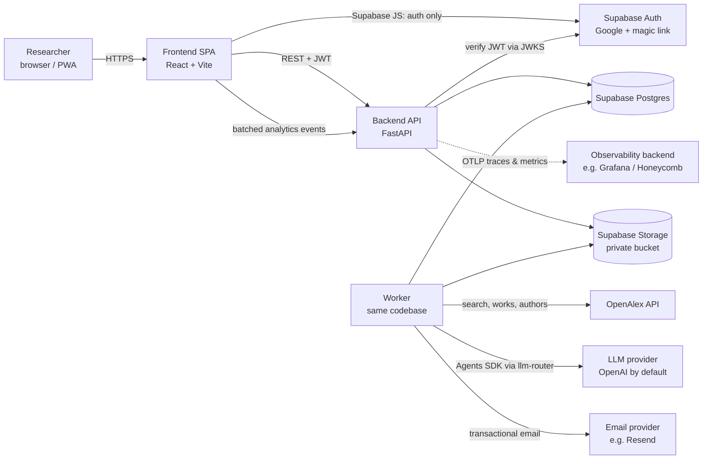
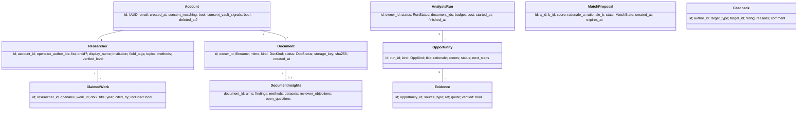
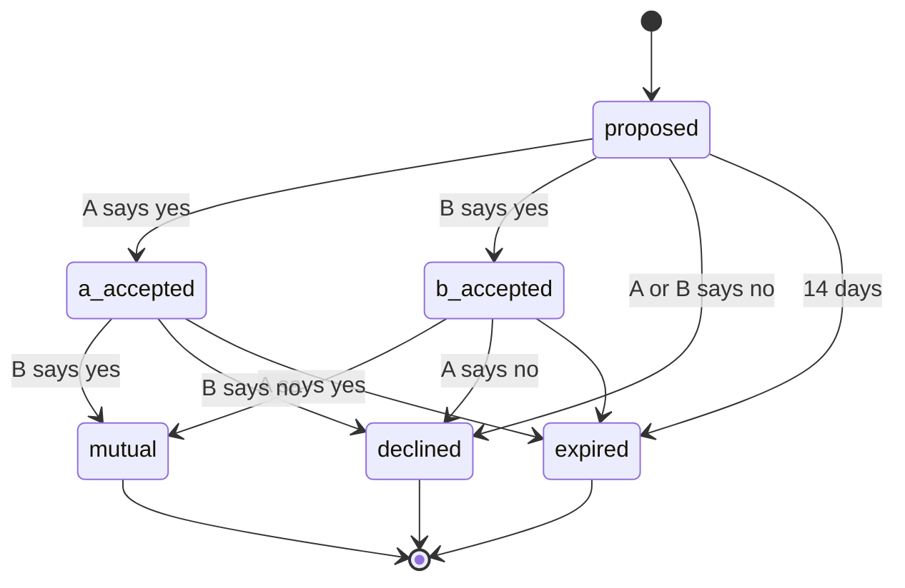
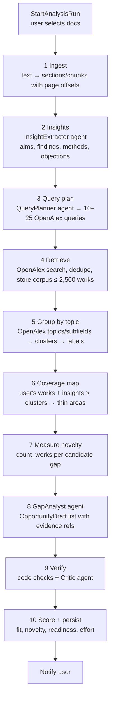
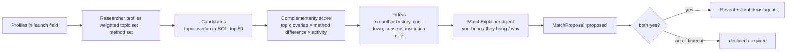

# Lattice Scout — MVP Architecture

> Version 0.2 · 20 Oct 2026 · Status: approved for implementation
> Audience: **Claude Code running unsupervised in cloud sessions**, and any human reviewer.
> Companion: `IMPLEMENTATION_PLAN.md` (execution protocol, milestones, tasks, acceptance criteria).

## 0. Read this first (Claude Code)

* This document says **what** to build and **why**. `IMPLEMENTATION_PLAN.md` says **in what order** and **how you work** (session protocol, git, CI, blockers). At the start of every session read §0.1 (decision register) here and §0 of the plan, then `PROGRESS.md`; read other sections on demand when a task needs them.
* You work **without a human in the loop**. When something is unclear, pick the option in the **Decision register (§0.1)**, or the simplest option consistent with this document, record it in `docs/DECISIONS.md`, and continue. Never stop to ask unless an item is listed as a hard stop in `IMPLEMENTATION_PLAN.md` §0.6.
* Words used precisely: **MUST** = required for the milestone to pass; **SHOULD** = do it unless it costs more than half a day, then log why not; **MAY** = optional, skip by default.
* The cloud VM (Ubuntu 24.04, 4 vCPU, 16 GB RAM) has Python 3 + uv, Node 22 + pnpm, Docker, and **PostgreSQL 16 pre-installed but not running**. The network allows package registries and GitHub only, unless the human widened it. **Nothing in the build or test path may need OpenAI, OpenAlex or Supabase network access** — use fakes and recorded fixtures.

### 0.1 Decision register (settled, so you never block)

| # | Topic | Decision for the MVP | Changeable later by |
|---|---|---|---|
| D1 | Frontend framework | **React 18 + TypeScript + Vite** (not Vue) | — |
| D2 | Backend | Python 3.12, FastAPI, Pydantic v2, SQLModel, Alembic, asyncpg/psycopg 3 | — |
| D3 | Auth | Supabase Auth (Google + magic link); backend verifies JWTs via JWKS (§10) | — |
| D4 | LLM access | Our **llm-router** package behind `LLMPort`. If the package source is not available in the environment (`LLM_ROUTER_SOURCE` unset or install fails), implement `OpenAIAgentsDirectAdapter` (OpenAI Agents SDK default provider) behind the same port, log a blocker, and continue | swapping the adapter in `bootstrap.py` |
| D5 | Embeddings / vector DB | **None** in the MVP (§6.6) | adding an `EmbeddingPort` adapter |
| D6 | Document retention (§16) | Implement `RETENTION_POLICY = keep \| discard \| user_choice`; **default `user_choice` with "keep original" unticked** (= process and discard unless the user opts in) | config only |
| D7 | Unverified claims | Persist with status and reason; never return them from user-facing endpoints (§4.4) | — |
| D8 | Job queue | Postgres table + `SKIP LOCKED` worker | `JobQueuePort` adapter |
| D9 | Local and test database | The VM's **PostgreSQL 16** (no Supabase stack needed for tests). Supabase is used for real Auth/Storage only in deployed environments | — |
| D10 | Storage in dev/test | `LocalFileStorage` adapter (filesystem); `SupabaseStorage` adapter covered by a contract test that is **skipped** when Supabase credentials are absent | config only |
| D11 | Email in dev/test | `ConsoleEmail` adapter (logs); `ResendEmail` adapter for production | config only |
| D12 | Analytics backend | First-party Postgres tables (§11); no third-party script | `AnalyticsPort` adapter |
| D13 | Table partitioning | Native Postgres declarative partitioning by month, partitions created by a scheduled job (no `pg_partman`) | — |
| D14 | Launch field | `bio-based-materials`, defined in `config/fields.yaml` | config only |
| D15 | Deployment | Out of scope for unsupervised work: provide Dockerfiles, `docker-compose.yml` and `docs/DEPLOY.md`, do **not** deploy | human |
| D16 | Auth without Supabase access | `AUTH_MODE=dev`: local ES256 key pair + `POST /dev/login` for dev, tests and Playwright; refused when `APP_ENV=prod` | config only |
| D17 | Live external calls | Only in tests marked `needs_network` / `needs_supabase` (skipped by default) and the manual live-eval workflow | — |
| D18 | Documentation | Continuous, per task (session journal, module READMEs, docstrings, ADRs, changelog, OpenAPI descriptions); consolidated into a MkDocs Material site with developer and user guides in M8. Docs checks run in CI | IMPLEMENTATION_PLAN §0.4b, M8 |
| D19 | Division of work in Claude Code | Main session on Sonnet implements and orchestrates; specialist subagents in `.claude/agents/` (architect, test-engineer, prompt-engineer, frontend-dev, debugger, reviewer, doc-writer) are called at fixed moments; only the main session commits | IMPLEMENTATION_PLAN §0.4c |

---

## 1. What we are building

Lattice Scout helps researchers **find new research opportunities** in their own unpublished work and **connect with complementary researchers**.

The MVP proves two AI capabilities end to end:

| Capability | User outcome | Value loop |
|---|---|---|
| **Gap analysis** | "Scout read my declined grant and unpublished data against the literature and showed me 3–10 evidence-backed opportunities." | Works for a single user. This is how people sign up. |
| **Matching** | "Scout proposed an anonymous researcher whose methods complement mine. We both said yes, and now we have each other's contact and two joint ideas." | Needs density, so it is what makes people stay. |

### 1.1 MVP scope

**In scope**

1. Sign-in with Supabase Auth (Google and email magic link).
2. Profile claim from **OpenAlex**: search the author, confirm works, merge split profiles. ORCID iD is optional and comes from OpenAlex. No ORCID API.
3. Private vault: upload **PDF and DOCX**, extract text, and extract structured insights. *(Open decision: whether originals are retained at all — see §16.)*
4. Gap-analysis run: literature retrieval from OpenAlex, clustering, gap detection, evidence verification.
5. Opportunity list and detail pages with linked evidence, plus feedback.
6. Matching on published work, anonymous proposals, **double opt-in**, contact reveal, joint-idea generation after the mutual yes, and match rating.
7. Email notifications: run finished, match proposal, mutual match.
8. Privacy basics: private storage, consent for matching, delete the vault, delete the account.

**Launch constraint:** one research field. The default is **bio-based materials** (cellulose, lignin, wood-derived materials). The field is configuration (`LAUNCH_FIELD`), not code.

**Out of scope for the MVP (roadmap):** chat assistant, voice and photo input, OCR of handwriting, the grant-objection tracker as its own feature, funding-call matching, reach map, native mobile app, Lattice Press integration, and Phase 2 non-user invitations (see §12).

### 1.2 Quality attributes (in priority order)

1. **Trust.** Every AI claim shown to a user carries a link to its source **at the point where the claim is made**: a DOI or OpenAlex work, or a passage in the user's own file (see §6.5). Claims we cannot verify are **kept but not shown** (status `unverified` / `rejected_by_critic`), so we can analyse how the system behaves and improve it.
2. **Privacy.** Vault content never leaves the backend except to the LLM provider under a no-training API agreement (enforced in code by ADR 015 and 016: confidential/published classes per input field; confidential parts are withheld from endpoints that are not authorized, and the run continues on published data; text derived from confidential input stays confidential, and search strings sent to OpenAlex are built from published data only). It is never shown to other users. Matching is anonymous until both sides agree.
3. **Replaceability.** LLM provider, literature source, storage, queue and email are swappable through ports (hexagonal architecture).
4. **Observability and cost control.** Every LLM call's input and output tokens, every external API call, every feature used and every page transition is recorded per user ID and per session from day one (§11), without slowing the app.
5. **Simplicity.** One backend service plus one worker process, Postgres-backed jobs, no embeddings or vector database in the MVP (§6.6), and no extra infrastructure until it is needed.

---

## 2. System context



* The **frontend talks to Supabase only for authentication**. All data access goes through the FastAPI backend. That keeps one place for authorization, privacy rules and audit logging.
* The **worker** runs long jobs: ingestion, analysis runs, profile import, match computation. It is the same Python package as the API, started with a different entry point.

---

## 3. Hexagonal architecture

### 3.1 Layers and dependency rule

```
               ┌──────────────────────── driving adapters ───────────────────────┐
               │  FastAPI routers   ·   Worker job handlers   ·   CLI (admin)    │
               └──────────────────────────────┬───────────────────────────────────┘
                                              │ calls inbound ports (use cases)
┌─────────────────────────────────────────────▼─────────────────────────────────────────────┐
│ APPLICATION  (use cases / services, orchestration, transactions, authorization checks)    │
│   ClaimProfile · UploadDocument · IngestDocument · StartAnalysisRun · RunGapAnalysis      │
│   ListOpportunities · GiveFeedback · ComputeMatches · DecideOnMatch · RateMatch · ...     │
└───────────────┬───────────────────────────────────────────────────────┬───────────────────┘
                │ uses                                                  │ depends on (interfaces)
┌───────────────▼───────────────┐                     ┌─────────────────▼─────────────────────┐
│ DOMAIN (pure Python)          │                     │ OUTBOUND PORTS (typing.Protocol)       │
│ entities, value objects,      │                     │ Repositories · LiteraturePort ·        │
│ invariants, state machines,   │                     │ LLMPort/agents · UsageMeter · Analytics│
│ domain events, scoring rules  │                     │ FileStoragePort · TextExtractionPort · │
│ NO framework imports          │                     │ JobQueuePort · NotificationPort ·      │
└───────────────────────────────┘                     │ AuthTokenVerifier · Clock · IdGen      │
                                                      └─────────────────┬─────────────────────┘
                                                                        │ implemented by
               ┌────────────────────────────────────────────────────────▼──────────────────┐
               │ DRIVEN ADAPTERS: SQLModel/Postgres repos · OpenAlexClient ·              │
               │ LlmRouterAdapter · BufferedUsageMeter · SupabaseStorage · PdfDocxExtractor│
               │ PostgresJobQueue · ResendEmail · SupabaseJwksVerifier · fakes for tests   │
               └───────────────────────────────────────────────────────────────────────────┘
```

**Rules (enforced with `import-linter` in CI):**

1. `domain` imports nothing outside the standard library and `pydantic`. Pydantic is used for value objects only, never for persistence.
2. `application` imports `domain` and `ports`, never `adapters`, `fastapi`, `sqlmodel` or `openai`.
3. `adapters` implement `ports`, may import any library, and never import `application` services.
4. `bootstrap` (the composition root) is the only module that wires adapters into services.
5. SQLModel table classes live in `adapters/persistence` and are **mapped** to domain entities. Domain entities are not ORM models. This keeps the domain testable and the ORM swappable.

### 3.2 Bounded contexts (modules)

| Context | Responsibility | Key aggregates |
|---|---|---|
| `identity` | Account, consent flags, deletion | `Account` |
| `profile` | Researcher profile from OpenAlex, claimed works, topics, methods | `Researcher`, `ClaimedWork` |
| `vault` | Private documents, extracted text, chunks, structured insights | `Document`, `DocumentInsights` |
| `discovery` | Analysis runs, literature corpus, clusters, opportunities, evidence | `AnalysisRun`, `Opportunity` |
| `matching` | Researcher vectors, proposals, decisions, reveal, joint ideas, ratings | `MatchProposal` |
| `feedback` | Ratings on opportunities and matches, used for evaluation | `Feedback` |
| `notifications` | Outbound email, templating, preferences | `Notification` |

Each context has the same internal layout (`domain/`, `application/`, `ports/`, `adapters/`). Shared kernel (`shared/`) holds IDs, `Clock`, `Result`, and base domain events.

---

## 4. Domain model

### 4.1 Core entities (simplified)



### 4.2 Enumerations

* `DocKind`: `funded_grant | declined_grant | proposal | unpublished_results | raw_data_description | lab_notes | other`
* `DocStatus`: `uploaded → extracting → extracted → analysing_insights → ready | failed`
* `RunStatus`: `queued → ingesting → retrieving → clustering → analysing → verifying → done | failed | cancelled`
* `OppKind` (MVP): `white_spot | synergy | resubmission` (`funding_call` later)
* `MatchState`: see §4.3

### 4.3 Match state machine (the double opt-in invariant)



**Invariants, enforced in the domain (`MatchProposal.decide()`):**

1. Identity fields (name, institution, email, ORCID) of the other party are **only** exposed by the read model when `state == mutual`.
2. A decline is never revealed to the other party. They only see "expired" or nothing.
3. Joint ideas are generated **after** the transition to `mutual`, never before.
4. A pair `(a, b)` can be proposed again only after a cool-down (default 180 days) and never after an explicit "never suggest similar".
5. Withdrawing a yes is allowed until `mutual`.

### 4.4 Opportunity invariants

* An opportunity is **shown** only if it has at least **2 verified evidence items**, at least one of them from the literature.
* Every claim is stored as a `Claim` (text, the opportunity it belongs to, its evidence refs, and a verification status: `verified | unverified | contradicted | rejected_by_critic`), with the reason and the step that set the status. Opportunities and claims that fail verification are **kept, never deleted, and never shown to users**. They are visible in the admin/evaluation views to understand failure modes (hallucinated IDs, quote mismatch, irrelevant evidence, already-published idea).
* Scores are bounded in `[0, 1]`: `fit`, `novelty`, `readiness`, `effort`. Novelty must be derived from a measured literature count (see §6.2), not from an LLM guess.

---

## 5. Ports (outbound interfaces)

Python `typing.Protocol`, all `async`. Signatures are indicative.

```python
class LiteraturePort(Protocol):
    async def search_authors(self, name: str, affiliation_hint: str | None) -> list[AuthorCandidate]: ...
    async def get_author(self, author_id: str) -> AuthorRecord: ...
    async def list_author_works(self, author_id: str, limit: int = 500) -> list[WorkRecord]: ...
    async def search_works(self, query: WorkQuery) -> list[WorkRecord]: ...          # title/abstract search + filters
    async def get_work(self, work_id_or_doi: str) -> WorkRecord | None: ...           # used by the evidence verifier
    async def count_works(self, query: WorkQuery) -> int: ...                         # novelty measurement
    async def citing_works_by_country(self, work_ids: list[str]) -> dict[str, int]: ... # roadmap (reach)

class EmbeddingPort(Protocol):             # NOT used in the MVP (§6.6); defined so it can be added later
    dim: int
    async def embed(self, texts: list[str]) -> list[list[float]]: ...

class LLMPort(Protocol):                   # implemented by the llm-router adapter
    async def run(self, agent: AgentSpec, input: Any, ctx: CallContext) -> AgentResult: ...
    # CallContext carries user_id, session_id, feature, run_id, prompt_version → usage tracking

class UsageMeterPort(Protocol):            # LLM + external API usage, non-blocking
    def record_llm_call(self, rec: LlmCallRecord) -> None: ...      # buffered, never awaits I/O on the hot path
    def record_external_call(self, rec: ExternalCallRecord) -> None: ...

class AnalyticsPort(Protocol):             # product analytics, non-blocking
    def track(self, evt: AnalyticsEvent) -> None: ...                # buffered

class InsightExtractorPort(Protocol):        # LLM-backed
    async def extract(self, doc_text: str, kind_hint: DocKind | None) -> DocumentInsights: ...

class GapAnalystPort(Protocol):              # LLM-backed
    async def propose(self, ctx: GapContext) -> list[OpportunityDraft]: ...

class CriticPort(Protocol):                  # LLM-backed + deterministic checks
    async def review(self, draft: OpportunityDraft, ctx: GapContext) -> CriticVerdict: ...

class MatchExplainerPort(Protocol):          # LLM-backed
    async def explain(self, a: ResearcherSummary, b: ResearcherSummary) -> MatchRationale: ...
    async def joint_ideas(self, a: ResearcherSummary, b: ResearcherSummary) -> list[JointIdea]: ...

class FileStoragePort(Protocol):
    async def put(self, key: str, data: bytes, content_type: str) -> None: ...
    async def get(self, key: str) -> bytes: ...
    async def delete_prefix(self, prefix: str) -> None: ...

class TextExtractionPort(Protocol):
    async def extract_text(self, data: bytes, mime: str) -> ExtractedText: ...   # pages/sections + offsets

class JobQueuePort(Protocol):
    async def enqueue(self, job: JobSpec) -> UUID: ...
    async def claim(self, worker_id: str, kinds: list[str]) -> Job | None: ...
    async def complete(self, job_id: UUID, result: dict) -> None: ...
    async def fail(self, job_id: UUID, error: str, retry_in: int | None) -> None: ...

class NotificationPort(Protocol):
    async def send(self, to: str, template: str, data: dict) -> None: ...

class AuthTokenVerifier(Protocol):
    async def verify(self, bearer_token: str) -> AuthPrincipal: ...   # sub, email, role, exp

# Repositories: one per aggregate (AccountRepo, ResearcherRepo, DocumentRepo, RunRepo,
# OpportunityRepo, MatchRepo, FeedbackRepo) plus a UnitOfWork with async commit/rollback.
```

**Adapters (MVP):** `OpenAlexClient` (httpx, API key, retry and backoff, response cache table), `LlmRouterAdapter` (wraps our **llm-router** package; the OpenAI Agents SDK agents run through it, see §6.1), `Agents*` (one adapter per LLM-backed port, built on `LLMPort`), `BufferedUsageMeter` and `BufferedAnalytics` (in-process queue + background batch writer to Postgres), `SupabaseStorage` (service-role key, private bucket), `PdfDocxExtractor` (`pypdf` or `pdfplumber` + `python-docx`), `PostgresJobQueue` (`SELECT … FOR UPDATE SKIP LOCKED`), `ResendEmail` (or SMTP), `SupabaseJwksVerifier` (PyJWT + JWKS cache).

**Test doubles:** an in-memory fake for every port lives in `tests/fakes/`. Use cases are tested only against fakes.

---

## 6. AI design

### 6.1 Principles

* **Deterministic pipeline, LLM steps inside.** The application layer orchestrates the run as explicit steps. Agents do bounded tasks with **typed outputs** (Agents SDK `output_type` = Pydantic model). We do not use free-form agent handoffs for the core pipeline. That keeps it testable, resumable and cheap.
* **Retrieval before generation.** The LLM only reasons over literature the system retrieved and stored for this run. It never cites from memory.
* **Verify, don't trust.** Evidence is checked by code first: DOI or OpenAlex ID exists, the quote is found in the stored chunk. The LLM critic then judges relevance.
* **Measured novelty.** Novelty comes from `count_works()` queries against OpenAlex, not from the model's opinion.
* **Model choice is configuration, routing is ours.** Model selection and provider routing go through our own **llm-router** package instead of LiteLLM. `LLM_MODEL_REASONING` and `LLM_MODEL_FAST` are route names/aliases resolved by llm-router.
  * *Integration (to confirm against llm-router's API at M0):* preferred: expose llm-router to the Agents SDK as a custom model provider, so agents keep `output_type`, tools and tracing; fallback: call llm-router directly inside the agent adapters with structured-output parsing into the Pydantic types.
  * Either way the domain only sees `LLMPort`, and **every call reports input, output, cached and reasoning tokens, model, latency and cost** to `UsageMeterPort` (§11.3).

### 6.2 Gap-analysis run (discovery context)



| Step | Kind | Notes |
|---|---|---|
| 1 Ingest | code | Text extraction with page offsets; split into sections/chunks (~800 tokens) with stable IDs so claims can point to an exact passage and page. No embeddings: grant and result documents fit into the model context directly (map-reduce for very long files). |
| 2 Insights | LLM (fast) | `InsightExtractor` → `DocumentInsights`. Reviewer objections are extracted verbatim with a chunk reference. |
| 3 Query plan | LLM (fast) | `QueryPlanner` → `list[WorkQuery]` from the profile topics and insights. Filters on publication year and field concepts. |
| 4 Retrieve | code | `LiteraturePort.search_works`, cached; keep title, abstract, year, concepts, DOI, cited_by. |
| 5 Group by topic | code + LLM (fast) | Group the corpus by the **topics/subfields OpenAlex already assigns to each work** (no embeddings). Merge tiny groups; split very large ones with an LLM labeler on titles; label each group (batch, cheap). |
| 6 Coverage | code + LLM (fast) | Map the user's own works (OpenAlex topics) and the vault insights (LLM tags the insights with the same topic labels) onto the groups; compute literature density per group. Candidate gaps = adjacent to the user, with low density. |
| 7 Novelty | code | For each candidate, 1–3 `count_works` queries over the last 5 years → `novelty = f(count)`. Store the counts as evidence. |
| 8 Analyse | LLM (reasoning) | `GapAnalyst` gets: the profile summary, insights, coverage table, novelty counts, top-k papers per cluster (id + title + abstract) and user chunks (id + text). Returns `OpportunityDraft[]`, each claim tied to `evidence_refs` (work IDs or chunk IDs + quotes). |
| 9 Verify | code + LLM | Code: every work ID exists in the run corpus or through `get_work`; every quote is a substring (normalized) of its chunk. LLM `Critic`: is the evidence relevant, is the claim supported, is the opportunity already done (checks the top similar papers)? Every claim gets a status and reason; failures are persisted, never discarded. |
| 10 Score | code | `fit` = topic overlap between the opportunity and the user's works and vault insights (weighted topic sets); `readiness` = share of required inputs already present in the vault (from the analyst's checklist); `effort` = from the analyst's estimate, bounded. |

**Budgets (per run, configurable):** max OpenAlex calls 400, max corpus 2,500 works, max LLM spend `RUN_BUDGET_USD` (default 1.50). Exceeding the budget degrades gracefully (fewer clusters analysed) and is logged.

**Resumability:** each step writes its outputs. A failed run restarts from the last completed step (`analysis_run.step`, `step_state` JSON).

### 6.3 Matching (matching context)



* **Topic set:** the OpenAlex topics of the researcher's last 5 years of works, weighted by recency and citation share (a sparse weighted set, no embeddings).
* **Method set:** methods and techniques extracted by an LLM from abstracts (plus vault insights only if `consent_vault_signals`), **normalised to a controlled vocabulary** for the launch field (`config/methods.yaml`, grown from the extractions and reviewed).
* **Score:** `complementarity = overlap(topics_a, topics_b)^α × (1 − overlap(methods_a, methods_b))^β × activity_factor`, with weighted Jaccard as `overlap`, α=1, β=1.5 by default, tuned on feedback.
* **Filters:** exclude existing co-authors (configurable, since a "reconnect" mode can be enabled), exclude the same research group, respect cool-down and consent.
* **Cadence:** nightly job plus on profile change. At most 3 open proposals per user per week.
* **Anonymous card content:** field, region (continent), career stage band, "you bring / they bring", score, and number of joint ideas (not the ideas). Nothing that allows trivial re-identification (no exact institution, no paper titles).
* **After mutual:** reveal name, institution, email and OpenAlex/ORCID links, and generate 1–3 joint ideas using both profiles and **only** vault signals that each side consented to.

### 6.4 Agents (OpenAI Agents SDK) — contracts

| Agent | Model tier | Input | `output_type` (Pydantic) | Tools |
|---|---|---|---|---|
| `InsightExtractor` | fast | document text (chunked, map-reduce if long), kind hint | `DocumentInsights` | none |
| `QueryPlanner` | fast | profile summary, insights | `QueryPlan(queries: list[WorkQuery])` | none |
| `ClusterLabeler` | fast | 10 titles per cluster | `ClusterLabel(label, description)` | none |
| `GapAnalyst` | reasoning | `GapContext` | `GapAnalysis(opportunities: list[OpportunityDraft])`, each draft = `claims: list[ClaimDraft]` with per-claim `evidence_refs` | `lookup_work(id)` (read-only, run corpus) |
| `Critic` | reasoning | one draft + its evidence texts + top similar papers | `CriticVerdict(keep, reasons, fixes)` | `search_similar(query)` (corpus) |
| `MatchExplainer` | fast | two `ResearcherSummary` | `MatchRationale` | none |
| `JointIdeas` | reasoning | two summaries (+ consented signals) | `JointIdeaList(ideas: list[JointIdea])` | none |
| `InsightTopicTagger` | fast | document insights + the run's cluster labels | `InsightTopicTags(tags: list[InsightTag])` (coverage step 6) | none |
| `MethodExtractor` | fast | up to 20 abstracts (or consented insights) + `config/methods.yaml` vocabulary | `MethodSet(methods: list[MethodMention])` (matching profiles) | none |

The full system prompts are in `prompts/<Agent>.md` (front-matter: name, version, model tier, output type, changelog). Prompts are versioned files. The prompt version is stored on every run and opportunity for evaluation.

**Guardrails:** an input guardrail that strips or flags personal data of third parties in vault text before matching use. An output guardrail that rejects drafts without `evidence_refs`. Tracing is on, with vault text **redacted** from traces (`trace_include_sensitive_data=False` or equivalent).

---

### 6.5 Surfacing sources at the point of the claim

Trust comes from being able to check a claim **where you read it**, not in a separate list.

* **Claim-level citations.** The `GapAnalyst` writes its rationale as a list of `Claim` objects, not free prose. Each claim has its own `evidence_refs`. The UI renders the rationale sentence by sentence, with a small numbered marker after each claim.
* **Marker behaviour.** Hover (desktop) or tap (mobile) on a marker opens a popover with:
  * **Literature:** title, authors, year, venue, the supporting sentence from the abstract, and buttons "Open DOI" / "Open in OpenAlex".
  * **User's own file:** document name, page, the exact quote highlighted, and "Open passage" (owner only; behaviour depends on the retention decision, §16).
  * **Measured count:** the query used, the number found, the date range, and "Run this search in OpenAlex".
* **Where markers appear.** Opportunity cards (on the one-line "why"), the opportunity detail (reasoning, objections, next steps, scores: each score links to the numbers behind it), match cards ("you bring / they bring" points link to the papers they come from), joint ideas after a mutual match, and Home briefing sentences.
* **Visible verification state.** Only verified claims are shown. A small "Verified · N sources" chip on each opportunity summarises this; a "How Scout checked this" link explains the steps.
* **Unverified material** (stored per §4.4) never reaches the user UI. It is available in an internal **Claims review** view: filters by status, failure reason, agent, prompt version and model, side by side with the evidence the model pointed to. This feeds prompt iterations and the eval set.

### 6.6 Embeddings: not needed for the MVP

| Where embeddings would normally be used | MVP replacement | Good enough because |
|---|---|---|
| Retrieval inside user documents | Put the whole document (or map-reduce summaries) in the context | Grants and result files are tens of pages; current context windows cover them |
| Grouping the literature corpus | OpenAlex topics/subfields already attached to every work | Curated, consistent, free, explainable to users |
| Matching researchers | Weighted topic sets + normalised method vocabulary, weighted Jaccard | Transparent scores ("you share 4 topics, differ in 3 methods"); easy to tune |
| Fit score | Topic overlap | Same |
| Evidence verification | Exact (normalised) quote matching | Deterministic and stricter than similarity |

**Benefits:** no vector store, no pgvector indexes, lower cost, simpler deletion (no derived vectors that could leak content), and scores users can understand.

**Limits to watch:** cross-topic synergies phrased differently (synonyms across subfields), very long documents, and fine-grained similarity between researchers in the same topic. If pilot feedback shows weak matching or missed synergies, add embeddings through the existing `EmbeddingPort` (pgvector in the same Supabase database) without touching the use cases.

---

## 7. Data model (Postgres, Supabase)

All tables have `id uuid pk`, `created_at`, `updated_at`. `owner_id` refers to `account.id` (= `auth.users.id`).

| Table | Key columns | Notes |
|---|---|---|
| `account` | `id = auth.users.id`, `email`, `consent_matching`, `consent_vault_signals`, `launch_field`, `deleted_at` | created on first API call |
| `researcher` | `account_id`, `display_name`, `orcid`, `institution`, `country`, `career_stage`, `topics jsonb`, `methods jsonb`, `verified_level` | |
| `researcher_openalex_id` | `researcher_id`, `openalex_author_id`, `merged bool` | split profiles |
| `claimed_work` | `researcher_id`, `openalex_work_id`, `doi`, `title`, `year`, `cited_by`, `abstract`, `included` | |
| `researcher_topic` | `researcher_id`, `openalex_topic_id`, `weight` | sparse topic set for matching |
| `researcher_method` | `researcher_id`, `method_term`, `weight`, `source (abstract/vault)` | normalised vocabulary |
| `document` | `owner_id`, `filename`, `mime`, `kind`, `status`, `storage_key`, `sha256`, `pages` | |
| `document_chunk` | `document_id`, `ord`, `text`, `page_from`, `page_to` | `text` depends on the retention decision (§16) |
| `document_insights` | `document_id`, `payload jsonb`, `prompt_version` | |
| `analysis_run` | `owner_id`, `status`, `step`, `step_state jsonb`, `budget jsonb`, `cost_usd`, `openalex_calls`, `prompt_versions jsonb`, `error` | |
| `run_document` | `run_id`, `document_id` | |
| `corpus_work` | `run_id`, `openalex_work_id`, `doi`, `title`, `abstract`, `year`, `cited_by`, `topics jsonb`, `cluster_id` | |
| `cluster` | `run_id`, `label`, `description`, `size`, `user_coverage`, `density` | |
| `opportunity` | `run_id`, `owner_id`, `kind`, `title`, `rationale`, `next_steps jsonb`, `fit`, `novelty`, `readiness`, `effort`, `status (shown/rejected_by_critic/dismissed/saved)` | |
| `claim` | `opportunity_id`, `ord`, `text`, `section (rationale/objection/next_step/score)`, `status (verified/unverified/contradicted/rejected_by_critic)`, `status_reason`, `set_by_step`, `agent`, `prompt_version`, `model` | kept even when not shown |
| `evidence` | `claim_id`, `source_type (work/chunk/count)`, `ref`, `quote`, `verified`, `check_result jsonb`, `detail jsonb` | one claim → many evidence |
| `match_proposal` | `a_id`, `b_id`, `score`, `rationale jsonb`, `state`, `a_decision`, `b_decision`, `expires_at`, `revealed_at` | unique on pair + active state |
| `joint_idea` | `match_id`, `title`, `summary`, `evidence jsonb` | |
| `feedback` | `author_id`, `target_type (opportunity/match)`, `target_id`, `rating`, `reasons text[]`, `comment` | |
| `notification` | `account_id`, `template`, `payload`, `sent_at`, `error` | |
| `job` | `kind`, `payload jsonb`, `status`, `attempts`, `run_after`, `locked_by`, `locked_at`, `error` | queue |
| `openalex_cache` | `key`, `response jsonb`, `fetched_at` | TTL 7 days |
| `audit_log` | `actor_id`, `action`, `target`, `at`, `meta` | reveal, delete, export |
| `app_session` | `id` (client-generated UUID), `account_id`, `started_at`, `last_seen_at`, `user_agent_family`, `device_type`, `viewport`, `app_version`, `entry_page`, `referrer_domain` | 30-min inactivity rotates the session |
| `analytics_event` | `ts`, `account_id`, `session_id`, `name`, `page`, `prev_page`, `dwell_ms`, `properties jsonb`, `client_ts`, `seq` | partitioned by month; see §11.2 |
| `llm_call` | `ts`, `account_id`, `session_id`, `run_id`, `feature`, `agent`, `route`, `provider`, `model`, `input_tokens`, `output_tokens`, `cached_input_tokens`, `reasoning_tokens`, `latency_ms`, `cost_usd`, `status`, `error_type`, `prompt_version`, `trace_id` | partitioned by month; see §11.3 |
| `external_call` | `ts`, `account_id`, `session_id`, `run_id`, `service (openalex/email/storage)`, `endpoint`, `status`, `latency_ms`, `cost_usd`, `cache_hit` | |

**Row Level Security** is enabled on every table with policies `owner_id = auth.uid()`, as defence in depth. The backend uses the service role but **always** filters by the authenticated principal in repositories. The frontend never queries tables directly.

**Migrations:** Alembic with SQLModel metadata. Monthly native partitions for `analytics_event` and `llm_call`, created ahead of time by a scheduled worker job (D13). No `vector` extension in the MVP. Migrations MUST run on plain PostgreSQL 16 (the cloud VM) and on Supabase Postgres; Supabase-only objects (RLS policies referencing `auth.uid()`) live in a separate migration branch applied only when `TARGET=supabase`.

---

## 8. API (FastAPI, `/api/v1`)

All endpoints require `Authorization: Bearer <supabase access token>` except `/health`.

| Method & path | Use case |
|---|---|
| `GET /me` | current account, consent, researcher summary |
| `PATCH /me/consent` | matching and vault-signal consent |
| `DELETE /me` | delete the account (async job) |
| `GET /profile/candidates?name=&affiliation=` | OpenAlex author candidates |
| `POST /profile/claim` | claim author IDs (multi), start import job |
| `GET /profile` · `PATCH /profile/works/{id}` | view profile, include/exclude a work |
| `POST /documents` (multipart) | upload PDF/DOCX → enqueue ingest |
| `GET /documents` · `GET /documents/{id}` · `PATCH /documents/{id}` (kind) · `DELETE /documents/{id}` | vault |
| `POST /runs` `{document_ids}` | start a gap-analysis run |
| `GET /runs/{id}` | status, step, progress %, cost |
| `GET /opportunities?run_id=&status=` · `GET /opportunities/{id}` | list, detail with evidence |
| `PATCH /opportunities/{id}` `{status}` | save or dismiss |
| `POST /feedback` | rate an opportunity or match |
| `GET /matches` · `GET /matches/{id}` | anonymous or revealed read model |
| `POST /matches/{id}/decision` `{accept: bool, never_similar?: bool}` | double opt-in |
| `POST /matches/{id}/rating` | 1–5 stars + reasons |
| `GET /evidence/{id}/open` | signed URL or passage for a vault chunk (owner only) |
| `POST /events` (batch, ≤ 100 events) | analytics ingestion; returns **202 immediately**, writes asynchronously (§11.2) |
| `GET /admin/claims` · `GET /admin/usage` · `GET /admin/analytics/*` | internal views (admin role only): claims review, token usage and cost, page paths and feature usage |

Every request carries `X-Session-Id` (client session UUID) and `X-Page` (current route). Middleware puts them, plus `account_id` and a request ID, into a context variable used by logs, traces, `UsageMeterPort` and `AnalyticsPort`.

Errors use RFC 9457 problem+json. Pagination is cursor-based. OpenAPI is generated and used to produce the TypeScript client (`openapi-typescript`).

---

## 9. Frontend

* **Choice:** React 18 + TypeScript + Vite, React Router, TanStack Query (server state), `@supabase/supabase-js` (auth only), Tailwind CSS with design tokens taken from the Lattice design (`IBM Plex Sans/Mono`, `Source Serif 4`, blue `#2446C7`, Scout purple `#5B3FB5`, teal `#0F6E6E`, ground `#F3F4F1`). Vue 3 would work equally well. React is chosen for the larger ecosystem of accessible component primitives and the generated OpenAPI client tooling.
* **PWA:** `vite-plugin-pwa`, installable, offline shell only (no offline data in the MVP).
* **Screens (MVP)** map to the design canvas: W0 sign-in, W1 claim profile, W2 home (slim), W3 vault, W4 run progress (simplified to a progress bar and steps), W5 opportunities, W6 opportunity detail, W7 matches, W10 privacy tab, and the burger navigation menu. Mobile layouts come from the M-series designs as responsive breakpoints.
* **Accessibility:** WCAG 2.1 AA. Real buttons and links, labels, visible focus, ≥44 px touch targets.
* **Evidence UI:** a shared `<Claim>` / `<SourceMarker>` component renders claim-level citations everywhere (§6.5), with keyboard-accessible popovers.
* **Analytics client:** `src/analytics/` (session ID, router listener, typed `track()`, batching, `sendBeacon`), no third-party script in the MVP.
* **Polling vs realtime:** poll `GET /runs/{id}` every 3 s while a run is active (simple). Supabase Realtime can replace it later through the same hook.

---

## 10. Security and privacy

| Concern | Measure |
|---|---|
| Auth | Supabase Auth (Google, magic link). Backend verifies access tokens with **asymmetric signing keys via JWKS** (`/auth/v1/.well-known/jwks.json`), checks `exp`, `iss` and `role = authenticated`, caches JWKS ≤ 10 min. No HS256 shared-secret verification. |
| Vault files | Private Supabase Storage bucket, key `vault/{owner_id}/{document_id}`, access only by the backend with the service role. Never public URLs. |
| LLM provider | Send only what a step needs. API data is not used for training under OpenAI's API terms; confirm this in the provider agreement before launch. Tracing redacts vault text. |
| Matching anonymity | Read model enforces §4.3. Proposals never contain paper titles, exact institution or vault content. |
| Deletion | `DELETE /me` and `DELETE /documents/{id}` cascade to chunks, insights, vectors, storage, and remove the user from future matching. Opportunities are deleted with their run. Audit-log the action. |
| Abuse | Rate limits per user (uploads, runs per day), file size ≤ 25 MB, MIME sniffing, PDF parsing in the worker with a timeout. |
| Secrets | `.env` locally; platform secret store in production. Never in the frontend except the Supabase URL and publishable key. |
| GDPR | Data processing record, export endpoint (roadmap), EU region for the Supabase project if EU users are the launch cohort. |

---

## 11. Operations

* **Runtime:** two processes from one image: `api` (uvicorn) and `worker` (`python -m scout.worker`). One Supabase project (Postgres, Auth, Storage).
* **Deployment:** Docker image to any container host (Cloud Run, Fly.io, Render, Azure Container Apps); frontend as static assets (Vercel, Netlify, Cloudflare Pages, or the same host). Infrastructure is not part of the domain, so pick the host your credits cover.
* **Observability, usage tracking and product analytics:** see §11.1–11.5 below.
### 11.1 Requirements

1. Know **from day one** which features are used, by whom (account ID) and in which session.
2. Retrace each user's path through the app: pages visited, order, time on page, and **which page they came from** when switching.
3. Track **every LLM call's input and output tokens** (plus cached and reasoning tokens), model, latency and cost, attributed to user, session, feature and run.
4. **No impact on speed or UX:** nothing on the request path waits for analytics I/O; the frontend never blocks on tracking.

### 11.2 Product analytics (frontend → backend)

* **Session:** the SPA creates a `session_id` (UUID v7) at first load, stores it in `sessionStorage`, rotates it after 30 minutes of inactivity, and sends it on every API call as `X-Session-Id`. After sign-in, events are tied to `account_id`; anonymous pre-login events are linked on sign-in.
* **Page transitions:** a router listener emits `page_view` on every route change with `page` (route pattern, e.g. `/opportunities/:id`, never raw IDs in the name), `prev_page`, and `dwell_ms` for the page being left. This gives the most-visited pages and the full transition matrix ("from which page they switch to another").
* **Feature events:** a small typed catalogue (`frontend/src/analytics/events.ts`, mirrored in `backend/.../analytics/catalogue.py`), e.g. `upload_started`, `upload_completed`, `run_started`, `run_viewed`, `opportunity_opened`, `evidence_marker_opened`, `evidence_source_clicked`, `opportunity_saved`, `opportunity_dismissed`, `feedback_given`, `match_viewed`, `match_decision`, `match_revealed`, `match_rated`, `menu_opened`, `menu_item_clicked`, `scout_fab_clicked`. Unknown names are rejected at ingestion.
* **Delivery without slowing the UI:** events go into an in-memory queue; flushed in batches every 10 s, at 20 events, and on `visibilitychange`/`pagehide` via `navigator.sendBeacon` (or `fetch(..., {keepalive: true})`). Scheduling uses `requestIdleCallback`. Failures are dropped after one retry (analytics must never break the app).
* **Ingestion:** `POST /events` validates the batch against the catalogue, enriches it (account, server timestamp, coarse device info), puts it on the in-process `BufferedAnalytics` queue and returns **202**. A background task bulk-inserts every 2 s or 500 events (`COPY`/multi-row insert). If the queue is full, events are sampled down, never blocking.
* **Privacy:** no vault content, no free text, no emails in event properties; IDs only. Users are told in the privacy notice; an opt-out flag stops non-essential events. Retention: raw events 13 months, then aggregated.

### 11.3 LLM and external usage tracking (backend)

* **Where:** inside `LlmRouterAdapter`, for every call (including each agent step and tool round-trip): `input_tokens`, `output_tokens`, `cached_input_tokens`, `reasoning_tokens`, model, route, provider, latency, status and error type, `cost_usd` (from a versioned price table in config), `prompt_version`, `trace_id`, plus `account_id`, `session_id`, `feature`, `run_id` from the `CallContext`.
* **Background work** (worker jobs) inherits the originating `account_id`, `session_id` and `feature` from the job payload, so a run started in a session is attributed to it.
* **External calls:** OpenAlex, email and storage calls are recorded the same way in `external_call` (with `cache_hit`).
* **Non-blocking:** `BufferedUsageMeter` appends to an in-memory queue and a background task batch-inserts. On shutdown the buffer is flushed. LLM usage is also stored as a per-run summary (`analysis_run.cost_usd`, token totals) for fast budget checks.

### 11.4 Technical observability

* **OpenTelemetry** for traces and metrics: FastAPI, httpx, SQLAlchemy and the worker job handlers instrumented; trace IDs propagated into `llm_call` and logs. Export via OTLP to a backend of choice (Grafana Cloud, Honeycomb, or self-hosted). Sampling: 100% errors, 20% normal traffic (configurable).
* **Agents SDK tracing** goes to the same place (custom trace processor), with vault text redacted.
* **Structured logs** (`structlog`, JSON) with `request_id`, `trace_id`, `account_id`, `session_id`.
* **Frontend:** Web Vitals (LCP, INP, CLS) sent as analytics events; JS errors to Sentry (optional).
* **Health:** `/health`, `/ready`; queue depth, job age and failure rate as metrics; alerts on budget thresholds, job failures and error-rate spikes.

### 11.5 What we can answer from day one (SQL views in `analytics` schema)

| Question | View |
|---|---|
| Which pages are visited most, per day / per user? | `v_page_views_daily` |
| From which page do users go to which page? | `v_page_transitions` (from, to, count, median dwell) |
| What path does a given user take in a session? | `v_session_paths` (ordered page list per session) |
| Which features are used, by how many users? | `v_feature_usage` |
| Funnels: upload → run → opportunity opened → source clicked → feedback | `v_funnel_discovery` |
| Funnels: proposal → viewed → accepted → mutual → rated | `v_funnel_matching` |
| Tokens and cost per user, per feature, per model, per day | `v_llm_usage_daily` |
| Cost per analysis run and per opportunity shown | `v_run_cost` |
| How often are claims unverified, why, with which prompt/model? | `v_claim_quality` |

A tool such as Metabase (or a PostHog adapter behind `AnalyticsPort`, if session replays are wanted later) can sit on top of these views without code changes.

### 11.6 Evaluation

* **Evaluation:** a golden set of 10–20 documents from the launch field (with owners' consent) with expected themes. `make eval` runs the pipeline on fakes or live and reports: verified-evidence rate, critic rejection rate, duplicate-of-existing-paper rate, and cost per run. Feedback ratings from users are the primary live metric.

---

## 12. Phase 2 hook: matching with non-users (design only)

Not built in the MVP, but the design leaves room:

* `researcher` rows can exist **without** an `account` (`account_id NULL`, `source = openalex_only`), built from OpenAlex only.
* `MatchProposal` supports `b_is_member = false`. On user A's yes, an `InviteNonMember` use case could email B **only** if a lawful contact route exists. Requires a legal review before activation (feature flag `MATCH_NON_MEMBERS`, default off).
* B joins → claims profile → the existing proposal resumes at `a_accepted`.

---

## 13. Repository layout

```
lattice-scout/
├─ CLAUDE.md                     # guidance for Claude Code (conventions, commands, rules)
├─ PROGRESS.md                   # session-to-session memory: done, in progress, next, blockers
├─ .claude/settings.json         # SessionStart hook: start Postgres, uv sync, pnpm install
├─ scripts/                      # dev_db.sh, fetch_fixtures.py (needs network), seed_dev.py
├─ docs/ ARCHITECTURE.md · IMPLEMENTATION_PLAN.md · DECISIONS.md · BLOCKERS.md · DEPLOY.md
│        CHANGELOG.md · HANDOVER.md · adr/ · screens/ · journal/ (one file per session)
├─ docs-site/                    # MkDocs Material: mkdocs.yml, dev/ (developer guide), user/ (user guide)
│                                #   API reference from openapi.json, Python reference via mkdocstrings
├─ .github/pull_request_template.md
├─ prompts/                      # versioned agent prompts (*.md with front-matter)
├─ tests/fixtures/               # shared test data: openalex/ (recorded API responses), vault/ (fictional sample docs)
├─ backend/
│  ├─ pyproject.toml             # uv; python 3.12
│  ├─ src/scout/
│  │  ├─ shared/                 # ids, clock, errors, events, result
│  │  ├─ identity/  profile/  vault/  discovery/  matching/  feedback/  notifications/
│  │  │   └─ README.md domain/ application/ ports/ adapters/    # per context; README = module guide
│  │  ├─ adapters/               # cross-cutting: persistence base, openalex, openai, supabase, email, queue
│  │  ├─ api/                    # FastAPI app, routers, schemas (DTOs), deps, error handlers
│  │  ├─ worker/                 # job loop, handlers
│  │  └─ bootstrap.py            # composition root (wires ports → adapters)
│  ├─ migrations/                # alembic
│  └─ tests/ unit/ integration/ contract/ e2e/ fakes/ fixtures/llm/
├─ frontend/
│  ├─ package.json               # pnpm; vite; react; ts
│  └─ src/ app/ routes/ features/{auth,profile,vault,runs,opportunities,matches,settings}/ ui/ api/
├─ eval/                         # golden set definitions + runner
├─ docker/ · docker-compose.yml  # api, worker, postgres (Supabase stack optional, not needed for tests)
└─ .github/workflows/ci.yml      # lint, typecheck, import-linter, tests, build, docs (strict build, links, interrogate)
```

---

## 14. Configuration

| Variable | Example / default |
|---|---|
| `SUPABASE_URL`, `SUPABASE_PUBLISHABLE_KEY` (frontend), `SUPABASE_SERVICE_ROLE_KEY` (backend only) | — |
| `SUPABASE_JWKS_URL` | `${SUPABASE_URL}/auth/v1/.well-known/jwks.json` |
| `DATABASE_URL` | Supabase Postgres connection string (pooler) |
| `OPENAI_API_KEY` (and any other provider keys llm-router needs) | — |
| `LLM_ROUTER_CONFIG` | path to the llm-router configuration (routes, fallbacks) |
| `LLM_MODEL_REASONING`, `LLM_MODEL_FAST` | llm-router route names, mapped to current models |
| `LLM_PRICE_TABLE` | `config/llm_prices.yaml` (per model, input/output/cached per 1M tokens, versioned) |
| `EMBEDDING_MODEL`, `EMBEDDING_DIM` | unset in the MVP (embeddings off, §6.6) |
| `ANALYTICS_ENABLED`, `ANALYTICS_FLUSH_MS`, `ANALYTICS_RETENTION_DAYS` | `true`, `2000`, `395` |
| `OTEL_EXPORTER_OTLP_ENDPOINT`, `OTEL_TRACES_SAMPLER_ARG` | observability backend, `0.2` |
| `OPENALEX_API_KEY`, `OPENALEX_MAILTO` | free key gives $1/day of usage; budget accordingly |
| `LAUNCH_FIELD` | `bio-based-materials` (maps to OpenAlex topic/concept filters in `config/fields.yaml`) |
| `RUN_BUDGET_USD`, `RUN_MAX_OPENALEX_CALLS`, `RUN_MAX_CORPUS` | `1.50`, `400`, `2500` |
| `MATCH_MAX_OPEN_PER_WEEK`, `MATCH_EXPIRY_DAYS`, `MATCH_EXCLUDE_COAUTHORS` | `3`, `14`, `true` |
| `EMAIL_PROVIDER`, `EMAIL_API_KEY`, `EMAIL_FROM` | — |
| `MATCH_NON_MEMBERS` | `false` (Phase 2) |
| `RETENTION_POLICY` | `user_choice` (D6) |
| `STORAGE_BACKEND` | `local` (dev/test) · `supabase` (deployed) |
| `LLM_BACKEND` | `fake` (tests, CI) · `llm_router` · `openai_direct` (D4 fallback) |
| `LITERATURE_BACKEND` | `fixtures` (tests, CI) · `openalex` |
| `LLM_ROUTER_SOURCE` | pip/uv requirement for our llm-router, e.g. `git+https://github.com/<org>/llm-router@<tag>` (set by the human) |
| `APP_ENV` | `test` · `dev` · `prod` |
| `AUTH_MODE` / `VITE_AUTH_MODE` | `dev` (local keys, D16) · `supabase` |

---

## 15. Architecture decisions (summary)

| ADR | Decision | Why |
|---|---|---|
| 001 | Hexagonal architecture with per-context modules | Swap LLM, literature source, storage or queue without touching use cases; test with fakes. |
| 002 | Backend owns all data access; frontend uses Supabase only for auth | One place for privacy rules and anonymity guarantees. |
| 003 | Deterministic pipeline orchestrating typed agents (no free handoffs) | Reproducible, resumable, testable, cost-bounded. |
| 004 | OpenAlex as the only literature source in the MVP | CC0 data, commercial use allowed, low cost; ORCID membership deferred. |
| 005 | **No embeddings in the MVP**; OpenAlex topics + controlled method vocabulary instead. If added later: pgvector in Supabase, not a separate vector DB | Simpler, cheaper, explainable scores; `EmbeddingPort` keeps the door open (§6.6). |
| 006 | Postgres-backed job queue | No Redis; adequate throughput; swappable via `JobQueuePort`. |
| 007 | Novelty measured by literature counts | Avoids hallucinated novelty; gives users a number they can check. |
| 008 | One launch field, configurable | Matching needs density; config keeps expansion cheap. |
| 010 | LLM access through our **llm-router** package (no LiteLLM) | Reuse in-house routing and fallbacks; single place to meter tokens and cost. Integration with the Agents SDK to confirm at M0. |
| 011 | Unverified claims are persisted, never shown | Lets us analyse failure modes and improve prompts; users only see verified claims with inline sources. |
| 012 | First-party analytics and usage metering in Postgres, buffered and asynchronous; OpenTelemetry for traces | Full data ownership, per user and session from day one, no added latency; tools (Metabase/PostHog) can be added on top. |
| 009 | **OPEN (provisional default D6) — Document retention: keep files in a vault, or process and keep only derived analyses?** | See §16. Built configurable; product owner confirms the default before the pilot. |

---

## 16. Open decision: document retention (decide before M2)

> **Decision needed:** keep uploaded documents in a vault, or process them once and keep only derived data (summary, keywords, extracted insights, short evidence quotes)?

| | Option A — Keep files (vault) | Option B — Process and discard | Option C — Hybrid (user choice) |
|---|---|---|---|
| What is stored | Original file + extracted text + chunks + insights | Summary, keywords, methods, insights, objections, short quotes; **no file, no full text** | B by default; user can tick "keep the original" per document |
| Evidence links ("open the exact passage") | Yes, verbatim quotes and page links | Only the short quotes captured at extraction time; no reopening the source | Full for kept files, limited for discarded ones |
| Re-analysis with better models or prompts later | Yes, re-run anytime | No; the user must re-upload | Only for kept files |
| Privacy and breach impact | Highest exposure (full unpublished work at rest) | Much lower; derived data only | User decides per file |
| Trust and adoption | Some researchers will refuse to upload | Easier to accept ("we read it, then delete it") | Best of both, slightly more UX |
| Legal / GDPR / IP | Storage of third-party personal data and confidential material; longer retention duties | Data minimisation; simpler retention policy | Clear consent per file |
| Storage cost | Higher | Minimal | Medium |

**Impact on the architecture (small, by design):**
* The hexagonal structure already isolates this: `FileStoragePort` becomes optional, and a new `RetentionPolicy` setting (`keep | discard | user_choice`) drives the `IngestDocument` use case.
* With **B**, `document_chunk.text` is replaced by `summary` + `quote` snippets (≤ 300 characters each, only those cited as evidence), and the original bytes are deleted right after ingestion (audit-logged).
* Evidence verification (§6.2 step 9) must then rely on quotes captured at ingestion. The `GET /evidence/{id}/open` endpoint shows the stored quote instead of the source passage.
* Derived data (insights, quotes, and embeddings if added later) can still reveal content. Treat it with the same protection in every option.
* Evidence markers (§6.5) for a discarded file show the stored quote and page number, with a note that the original was not kept.

**Recommendation to evaluate:** start with **C (hybrid), defaulting to "process and discard"**, and measure how often users choose to keep originals during the pilot. Record the final decision as ADR-009.

**Provisional implementation (D6, so the build is not blocked):** implement all three policies behind `RETENTION_POLICY`, default `user_choice` with "keep original" unticked. The product owner confirms or changes the default before the pilot; it is a configuration change only.
