# Lattice Scout — MVP Implementation Plan

> Version 0.2 · 20 Oct 2026 · Companion to `ARCHITECTURE.md`
> Written to be executed **unsupervised by Claude Code in cloud sessions**, milestone by milestone, with all work pushed to GitHub.

---

## 0. Execution protocol (read every session)

### 0.1 The environment you are in

* Fresh Ubuntu 24.04 VM per session (4 vCPU, 16 GB RAM, 30 GB disk), the repository already cloned.
* Pre-installed: Python 3 with `uv`, Node 22 with `pnpm`, Docker, **PostgreSQL 16 (not running: `service postgresql start`)**.
* Network: package registries and GitHub. **Assume OpenAI, OpenAlex and Supabase are unreachable.** Build and test only with fakes and recorded fixtures (`LLM_BACKEND=fake`, `LITERATURE_BACKEND=fixtures`, `STORAGE_BACKEND=local`, `EMAIL_PROVIDER=console`).
* Foreground commands time out after ~2 minutes (up to 10 if requested); long commands move to the background. Keep single test runs short; split slow suites with markers.
* Sessions can end or pause at any time. Anything not committed and pushed may be lost.

### 0.2 Start of every session (do these in order)

1. Read `CLAUDE.md`, `PROGRESS.md`, `docs/BLOCKERS.md`, this file's §0 and the current milestone in §2, and ARCHITECTURE §0.1. Other sections on demand.
2. Run the SessionStart steps if the hook did not (from M0 on, `.claude/settings.json` does it): `service postgresql start`, `scripts/dev_db.sh` (creates role/db `scout`, `scout_test` if missing), `uv sync` in `backend/`, `pnpm install` in `frontend/`.
3. `git fetch --all`, check out the branch named in `PROGRESS.md` → "Current branch", or create the next milestone branch per the merge policy (`stack`: from the previous milestone branch; `self-merge`: from `main`).
4. Run `make check`. If it is red on a clean checkout, fixing it is the first task.
5. Open today's session journal `docs/journal/YYYY-MM-DD-sNN.md` (goal of the session first) and link it from `PROGRESS.md`.
6. Continue with the first unchecked task of the current milestone in `PROGRESS.md`.

### 0.3 Working loop

* One task at a time: write or extend tests (fakes first) → implement → `make check` → commit.
* **Commit small and often** (at least every completed task, and before any long command). Conventional commits: `feat(discovery): …`, `test(matching): …`, `fix(api): …`, `chore: …`, `docs: …`.
* **Push after every commit**: `git push -u origin <branch>`. Pushes only go to milestone branches, never directly to `main`.
* After each task, update `PROGRESS.md` (tick the task, note anything the next session must know), the session journal and the docs listed in §0.4b, and commit them with the task. A task's commit without its docs is incomplete.
* Do not add features outside the milestone. Ideas go into `docs/BACKLOG.md`.
* Every decision not covered by ARCHITECTURE §0.1 goes into `docs/DECISIONS.md` (date, context, decision, consequence). Larger ones get an ADR in `docs/adr/`.

### 0.4 Git and GitHub workflow

* Branches: `m0-foundations`, `m1-auth-profile`, `m2-vault`, `m3-gap-engine`, `m4-opportunities-ux`, `m5-matching`, `m6-hardening`, `m7-pilot`, `m8-docs`.
* When a milestone's acceptance criteria and the Definition of Done are met:
  1. Open a pull request to `main` titled `M<n>: <name>`, with the summary, demo script, decisions taken and known gaps.
  2. Wait for GitHub Actions CI. If you can read the CI status (built-in GitHub tools or `gh`), fix until green. If you cannot read it, `make check` locally is the gate; say so in the PR.
  3. Follow the **merge policy** at the top of `PROGRESS.md`:
     * `Merge policy: stack` (**default**): leave the PR open for the human, create the next milestone branch **from the previous milestone branch** (not from `main`), and open its PR against the previous branch. Record the stack in `PROGRESS.md`. If the human merges a PR in the meantime, rebase nothing: merge `main` into the current branch and continue.
     * `Merge policy: self-merge`: squash-merge the PR yourself once checks are green, tag `main` with `m<n>` if tag pushes are allowed (otherwise record the merge SHA in `PROGRESS.md`), and branch the next milestone from `main`.
  4. If a merge or PR creation is not permitted by the environment, fall back to `stack` and note it.
* Never force-push to `main`, never delete branches, never rewrite history that was already pushed.
* `.gitignore` MUST exclude `.env*` (except `.env.example`), `node_modules`, `.venv`, local storage folders and coverage output.

### 0.4b Document everything, every step of the way

Documentation is part of every task, not a phase at the end. Nothing is "done" until it is documented.

**Continuously (every task / every session):**

| What | Where | When |
|---|---|---|
| Session journal: goal, what was done, commands run, problems met and how they were solved, decisions, what's next | `docs/journal/YYYY-MM-DD-sNN.md` (one file per session, linked from `PROGRESS.md`) | written during the session, committed with the last commit of the session at the latest |
| Decisions (small) | `docs/DECISIONS.md` | when taken |
| Architecture decisions (significant) | `docs/adr/NNN-title.md` (context, options, decision, consequences) | when taken |
| Changes visible to users or developers | `docs/CHANGELOG.md` (Keep a Changelog format) | every merged PR |
| Code-level documentation | Docstrings (Google style) on every public class, function, port and use case; TSDoc on exported React components and hooks; comments only for the non-obvious "why" | with the code |
| Module guide | `backend/src/scout/<context>/README.md`: purpose, domain model, use cases, ports, adapters, events, invariants, how to test | created with the module, updated when it changes |
| API | OpenAPI descriptions, summaries and examples on every endpoint and schema field | with the endpoint |
| Agent prompts | Front-matter in `prompts/*.md`: purpose, inputs, output schema, version, changelog of the prompt | with every prompt change |
| Config | Every variable documented in `.env.example` and `docs-site/dev/configuration.md` | when added |
| User-facing behaviour | A short note in `docs-site/user/` for the feature being built (finished in M8) | with the feature |

**PR description template** (`.github/pull_request_template.md`, created in M0): summary, why, what changed per module, screenshots (from Playwright), how it was tested, docs updated (checklist), decisions, known gaps.

**Docs are checked in CI:** markdown lint, link check (internal links), docs site builds without warnings, and a script that fails if a public Python symbol in `domain`, `application` or `ports` lacks a docstring (`interrogate` ≥ 95%) or if an endpoint lacks a summary.

### 0.4c Division of work: which agent does what, and when

You (the main session) are the **lead developer and orchestrator**. You own the plan, the backend implementation, the session journal, every commit and every push. Specialist subagents in `.claude/agents/` do bounded jobs on cheaper or stronger models. Call them with the Agent tool by name, at the moments listed below. Do not wait to be asked.

**Model set-up.** The human starts every session on **Sonnet** (main session). Opus is used only through the `architect`, `prompt-engineer`, `debugger` and `reviewer` subagents; Haiku through `doc-writer`. This keeps the cost low and puts the strong model where reasoning matters.

| Agent | Model | Job | Writes | Call it |
|---|---|---|---|---|
| `architect` | Opus | Design note before a hard task | `docs/design/*.md`, `docs/DECISIONS.md` | Before every task tagged **[architect]** |
| `test-engineer` | Sonnet | Failing tests first, from the spec | `backend/tests/**`, `frontend/**/*.test.ts(x)` | Before every task tagged **[test-first]** |
| `prompt-engineer` | Opus | Runtime agent prompts, LLM fixtures, eval cases | `prompts/`, `backend/tests/fixtures/llm/`, `eval/cases/` | Tasks tagged **[prompt]**; when eval or the Claims review shows a failure pattern |
| `frontend-dev` | Sonnet | Screens and components matching `docs/screens/` | `frontend/**` | Every task tagged **[frontend]** |
| `debugger` | Opus | Root cause of a stuck failure | minimal fix | After **2 failed attempts** on the same failure |
| `reviewer` | Opus | Independent milestone review | `docs/reviews/M<n>.md` | End of every milestone, after `make check` is green; again after fixing blocking findings |
| `doc-writer` | Haiku | Module READMEs, CHANGELOG, user notes, docs site | `**/README.md`, `docs/CHANGELOG.md`, `docs-site/**` | End of every milestone (before `reviewer`), when a new bounded context is created, and for all of M8 |

**Delegation map** (task numbers refer to §2; B = backend task, F = frontend task):

| Milestone | [architect] | [test-first] | [prompt] | [frontend] | doc-writer / reviewer |
|---|---|---|---|---|---|
| M0 | 3–4 shared kernel and composition root; 11 LLM port + llm-router integration; 12 observability (buffered, non-blocking) | 2 import-linter contract test | — | 9 shell, burger menu, tokens, analytics client | 10b docs scaffolding; review |
| M1 | B4 author candidate grouping and claim flow | B1 JWT verifier + dev auth; B3 `LiteraturePort` contract tests | — | F1–F3 | module READMEs identity, profile; review |
| M2 | B3 document state machine + retention policies; B5 agent factory | B3 retention and deletion tests | `InsightExtractor` | F1–F2 | README vault; review |
| M3 | 1 discovery domain; 3 step handlers + resumability; 4 budgets | 3.7 evidence verification (deterministic checks); resume-after-kill test | `QueryPlanner`, `ClusterLabeler`, `InsightTopicTagger`, `GapAnalyst`, `Critic`; 6 eval cases | — | README discovery; review |
| M4 | — | — | — | 1–4, 6, and the UI part of 5 (incl. shared `<Claim>` / `<SourceMarker>`); you do the backend of 5 | user notes "Finding opportunities"; review |
| M5 | 1 match aggregate; 3 complementarity scoring and filters; 4 read models | 1 state machine + reveal rule (Hypothesis); 4 "revealed fields unloadable unless mutual" | `MethodExtractor`, `MatchExplainer`, `JointIdeas` | 7 | README matching; user notes "Matching"; review |
| M6 | 2 account deletion job; 3 budget guard | 2 "no rows or files left" scan test | — | 2 privacy tab, preferences | review with a security focus |
| M7 | — | — | — | 2–3 invite flow, admin page | `DEPLOY.md`, `PILOT_RUNBOOK.md`; review |
| M8 | — | — | — | 3 docs screenshots spec | everything in M8; final review |

**How to delegate well**
* Pass a short brief: task id, acceptance criteria, the files or design note to read. Never paste whole documents; the agent reads them.
* Run subagents **one at a time** (they may edit files; parallel edits collide). Review their diff before you commit.
* **Only the main session commits and pushes.** Commit the subagent's work with the task, e.g. `test(matching): reveal invariants (test-engineer)`.
* Record every delegation in the session journal: agent, task, result, follow-ups.
* **Caps** (cost control): `architect` once per tagged task (+1 revision if the design proves wrong); `debugger` at most twice per failure, then log a blocker and move on; `reviewer` at most twice per milestone; `prompt-engineer` once per agent in the build, then only on evidence from eval or Claims review.
* Do it yourself, without a subagent, for everything else: routine backend code, migrations, endpoints, wiring, fixes you understand, the session journal, docstrings.
* If a subagent cannot run (model unavailable, error), do its job yourself following its file in `.claude/agents/`, and note it in the journal.

### 0.5 Blockers: keep moving

If something cannot be done in this environment (missing credential, unreachable service, private package not installable):

1. Write it in `docs/BLOCKERS.md`: what, why, what you did instead, what a human must do to unblock (exact steps).
2. Use the fallback: a fake adapter, a recorded fixture, a skipped test marked `@pytest.mark.needs_network` or `needs_supabase`, or the D-decisions in ARCHITECTURE §0.1 (for example D4 for llm-router).
3. Continue with the next task. A blocker never stops the milestone unless it is a hard stop (§0.6).

### 0.6 Hard stops (the only reasons to stop and wait)

* Any action that would need real secrets committed to the repo.
* Any request to deploy, spend money, send real emails, or call paid APIs at scale.
* A test that would contact real users or real researchers (emails, invitations).
* Requirements in ARCHITECTURE and this plan that contradict each other in a way the decision register does not resolve. Record the conflict in `docs/BLOCKERS.md`, finish everything else, and stop.

### 0.7 Definition of Done (every milestone)

- [ ] `make check` passes: ruff, mypy (strict on `domain` and `application`), import-linter, pytest (unit + integration on the VM's PostgreSQL 16), eslint, tsc, vitest, frontend build.
- [ ] New use cases have unit tests (fakes) and at least one integration test (real Postgres).
- [ ] No test requires network access except those marked `needs_network` / `needs_supabase`, which are skipped by default.
- [ ] No secrets in the repo; `.env.example` lists every variable with a safe default.
- [ ] API changes reflected in the OpenAPI schema and the regenerated TypeScript client (`make gen-client`).
- [ ] UI matches the referenced screens in `docs/screens/` (layout, copy, tokens), keyboard-accessible, works at 390 px wide; a Playwright smoke test covers the main path of the milestone.
- [ ] Documentation per §0.4b: session journals written, module READMEs and docstrings complete, OpenAPI described, ADRs for significant decisions, user notes for new features, docs CI green.
- [ ] Delegations per §0.4c done: design notes for [architect] tasks, tests-first for [test-first] tasks, `reviewer` verdict `approve` in `docs/reviews/M<n>.md`.
- [ ] `PROGRESS.md`, `docs/CHANGELOG.md` and `docs/DECISIONS.md` updated; PR opened with the template filled in; merged (or stacked) as in §0.4.

### 0.8 `PROGRESS.md` format (create in M0)

```markdown
# Progress
Merge policy: stack
Current milestone: M2 — Vault + ingestion
Current branch: m2-vault
Last session: 2026-10-21 — finished task 3, task 4 in progress (IngestDocument chunking done, insights not started)

## M0 — Foundations ✅ merged (sha abc1234)
## M1 — Auth + profile ✅ merged (sha def5678)
## M2 — Vault + ingestion
- [x] 1 FileStoragePort + LocalFileStorage
- [x] 2 TextExtractionPort + PdfDocxExtractor
- [ ] 3 IngestDocument job  ← next
...
## Notes for next session
- pdfplumber is slow on scanned PDFs; added 60 s timeout (DECISIONS #7)
## Open blockers
- B1 llm-router source not configured → using OpenAIAgentsDirectAdapter (see BLOCKERS.md)
```

### 0.9 One-time setup by the human (before the first session)

1. Create an empty GitHub repository and connect it to Claude Code (claude.ai/code → GitHub).
2. Commit the hand-off bundle as is (unzipped at the repository root): `CLAUDE.md`, `PROGRESS.md`, `.claude/` (agents + settings), `docs/`, `prompts/`, `scripts/`, `tests/fixtures/openalex/`.
3. Create a cloud environment:
   * **Network:** Trusted (default) is enough to build everything. *Optional for live evaluation later:* Custom with the default list plus `api.openalex.org`, `api.openai.com`, `<project>.supabase.co`, and network secrets for the OpenAI key.
   * **Environment variables:** `APP_ENV=dev`, `LLM_BACKEND=fake`, `LITERATURE_BACKEND=fixtures`, `STORAGE_BACKEND=local`, `EMAIL_PROVIDER=console`, `BASH_DEFAULT_TIMEOUT_MS=300000`, and `LLM_ROUTER_SOURCE=<uv requirement for llm-router>` only if you do **not** add the `llm-router` repository to the session (adding it as a second repository is the simplest way; the Claude GitHub App must be installed on it). Optional later: `OPENALEX_API_KEY` (free key; needed for live OpenAlex calls and `scripts/fetch_fixtures.py`).
   * **Setup script:**
     ```bash
     #!/bin/bash
     uv python install 3.12 || true
     npm install -g pnpm@9 || true
     apt-get update && apt-get install -y --no-install-recommends poppler-utils || true
     exit 0
     ```
4. Start the first session with the kickoff prompt from `docs/claude-code-prompts.md` (delivered in the hand-off bundle).

---

## 1. Milestones at a glance

| # | Milestone | Outcome | Size* |
|---|---|---|---|
| M0 | Foundations | Repo, tooling, CI, hexagonal skeleton, local Postgres, observability, health check | S |
| M1 | Auth + profile claim | Sign in with Google or magic link; claim your OpenAlex profile and works | M |
| M2 | Vault + ingestion | Upload PDF/DOCX; text, chunks with page offsets, structured insights | M |
| M3 | Gap analysis engine | Full run pipeline producing verified opportunities (backend) | L |
| M4 | Opportunities UX + feedback | Run progress, opportunity list and detail with evidence, feedback | M |
| M5 | Matching | Topic/method profiles, proposals, double opt-in, reveal, joint ideas, rating | L |
| M6 | Notifications, privacy, hardening | Emails, consent, deletion, rate limits, budgets, observability, eval | M |
| M7 | Pilot launch (one field) | Seeded cohort, invites, monitoring, feedback dashboard | S |
| M8 | Documentation | Complete developer and user documentation site | M |
| P2 | (later) Non-member matching | Invite flow behind a feature flag after legal review | M |

*S ≈ 1–3 Claude Code sessions, M ≈ 3–6, L ≈ 6–10. Order of execution: **M0 → M1 → M2 → M3 → M4 → M5 → M6 → M7 → M8**, sequentially in one branch line (unsupervised runs avoid parallel branches to prevent merge conflicts).

```mermaid
gantt
  dateFormat  X
  axisFormat %s
  section Core
  M0 Foundations        :m0, 0, 1
  M1 Auth+Profile       :m1, after m0, 2
  M2 Vault              :m2, after m1, 2
  M3 Gap engine         :m3, after m2, 4
  M4 Opportunities UX   :m4, after m3, 2
  M5 Matching           :m5, after m1, 4
  M6 Hardening          :m6, after m4, 2
  M7 Pilot              :m7, after m6, 1
  M8 Documentation      :m8, after m7, 2
```



M5 technically depends only on M1, but run it after M4 in unsupervised mode. P2 is **not** part of the unsupervised run.

---

## 2. Milestone details

### M0 — Foundations

**Tasks**
1. Monorepo layout as in ARCHITECTURE §13. `backend/` with `uv`, Python 3.12; `frontend/` with pnpm, Vite, React, TypeScript.
2. Backend tooling: ruff, mypy, pytest, pytest-asyncio, import-linter contracts (domain ⟂ adapters, application ⟂ adapters/fastapi/sqlmodel/openai).
3. `shared/` kernel: `EntityId`, `Clock` port + `SystemClock` + `FixedClock`, `DomainError` hierarchy, `DomainEvent`, `UnitOfWork` protocol.
4. `bootstrap.py` composition root with a `Container` (plain functions, no DI framework) selecting real or fake adapters from settings (`pydantic-settings`).
5. FastAPI app factory, `/health`, `/ready` (DB ping), problem+json error handler, request-ID middleware, structlog.
6. Worker entry point with the job loop over `JobQueuePort` (`PostgresJobQueue` adapter, `SKIP LOCKED`, retries with backoff) and a no-op `ping` job.
7. Local dev on the VM: `scripts/dev_db.sh` (idempotent: start PostgreSQL 16, create roles/dbs `scout` and `scout_test`), the SessionStart hook (already provided: `.claude/settings.json` → `scripts/session_start.sh`, which runs `dev_db.sh`, `uv sync` and `pnpm install` with timeouts once they exist; extend it if needed), `docker-compose.yml` (api, worker, postgres) for other machines, `Makefile` (`dev`, `check`, `test`, `test-integration`, `migrate`, `gen-client`, `eval`, `e2e`, `docs`, `docs-check`). Update the provided `PROGRESS.md`; create `docs/DECISIONS.md`, `docs/BLOCKERS.md`, `docs/BACKLOG.md`, `docs/CHANGELOG.md`.
8. Alembic setup; first migration: `job`, `account`, `audit_log` (plain PostgreSQL 16; Supabase-only RLS in a separate migration applied when `TARGET=supabase`).
9. Frontend shell: router, layout with the header and the burger menu (from `NavMenu` design), design tokens (Tailwind theme), fonts, the Scout FAB placeholder, the empty pages.
10. CI workflow: backend checks, frontend lint, types, tests, build, docs checks (§0.4b). Trigger on every push and on pull requests to **any** branch (stacked PRs target milestone branches, not `main`).
10b. Documentation scaffolding: `docs/journal/`, `docs/adr/000-template.md` and ADRs 001–012 copied from ARCHITECTURE §15, `.github/pull_request_template.md`, `docs-site/` skeleton (MkDocs Material, `dev/` and `user/` sections with stub pages), `interrogate` and markdown-lint configs.
11. **LLM port and adapters:** `LLMPort` with `FakeLLM` (deterministic, schema-valid outputs from fixtures; used in all tests). If `LLM_ROUTER_SOURCE` installs, implement `LlmRouterAdapter` and decide between "custom model provider for the Agents SDK" and "direct calls with structured output" (ADR-010 follow-up); otherwise implement `OpenAIAgentsDirectAdapter` (D4) and log blocker B1. Either real adapter MUST capture input/output/cached/reasoning tokens into `UsageMeterPort`; its live test is marked `needs_network`.
12. **Observability foundations (from day one):**
    * Request context middleware (`X-Session-Id`, `X-Page`, account, request ID → contextvars).
    * `UsageMeterPort` + `BufferedUsageMeter`; tables `llm_call`, `external_call` (monthly partitions); price table `config/llm_prices.yaml`.
    * `AnalyticsPort` + `BufferedAnalytics`; tables `app_session`, `analytics_event`; `POST /events` (202, async bulk insert); event catalogue (backend + frontend).
    * Frontend `src/analytics/`: session ID, router `page_view` with `prev_page` and `dwell_ms`, batched `track()`, `sendBeacon` on `pagehide`, Web Vitals.
    * OpenTelemetry (FastAPI, httpx, SQLAlchemy, worker) with OTLP export; structlog with trace IDs.
    * SQL views `analytics.v_page_views_daily`, `v_page_transitions`, `v_session_paths`, `v_feature_usage`, `v_llm_usage_daily`.

**Acceptance**
* `make dev` starts api and worker against the VM's PostgreSQL 16; `GET /health` → 200; an enqueued `ping` job completes.
* A new cloud session on the branch reaches a green `make check` with no manual steps (SessionStart hook works).
* Navigating 5 pages in the shell produces 5 `page_view` rows with correct `prev_page`, `dwell_ms` and one `session_id`; `v_page_transitions` shows them.
* A test agent call through `LLMPort` writes an `llm_call` row with input and output tokens and cost (offline: `FakeLLM` reporting synthetic token counts satisfies this; the llm-router or D4 adapter's live test is `needs_network`).
* Load test: `POST /events` p95 < 20 ms and API p95 unchanged (± 5%) with analytics on vs off.
* An import-linter violation fails CI (demonstrated by a test contract).

---

### M1 — Auth + profile claim

**Screens:** W0 Sign in, W1 Claim profile (`docs/screens/web/W0-signin.png`, `docs/screens/web/W1-claim-profile.png`, mobile M0, M1; index in `docs/screens/README.md`).

**Backend tasks**
1. **[test-first]** `AuthTokenVerifier` port; `SupabaseJwksVerifier` adapter (PyJWT `PyJWKClient`, cache ≤ 10 min, verify `exp`, `iss`, `role`). FastAPI dependency `current_principal`. Contract test with a locally signed ES256 token + a fake JWKS. **Dev auth mode** (`AUTH_MODE=dev`, never allowed when `APP_ENV=prod`): the backend trusts a local ES256 key pair (`var/dev-keys/`, generated by `scripts/dev_keys.py`, git-ignored) and exposes `POST /dev/login {email}` returning a token, so the app, tests and Playwright run without reaching Supabase.
2. `identity`: `Account` aggregate, `EnsureAccount` use case (create on first call), `GET /me`, `PATCH /me/consent`.
3. `LiteraturePort` + `OpenAlexClient`: `search_authors`, `get_author`, `list_author_works` (cursor paging), API key, `mailto`, retries on 429/5xx, `openalex_cache` table, budget counter. `FixtureLiterature` adapter serving recorded responses from `tests/fixtures/openalex/*.json` (supplied in the hand-off bundle for Johan Foster `A5059588273` and Raphaell Moreira `A5033675494`; if missing, create small synthetic fixtures with the same schema and log a blocker). `scripts/fetch_fixtures.py` refreshes them when network allows (`needs_network`). The live `OpenAlexClient` contract test is `needs_network`.
4. `profile`: `Researcher`, `ClaimedWork`; use cases `FindAuthorCandidates` (name + optional affiliation; groups split profiles by shared ORCID or institution), `ClaimProfile` (one or more author IDs → enqueue `profile.import`), `ImportProfile` job (works, topics from OpenAlex topics, institution, country), `ToggleWork`.
5. Endpoints: `GET /profile/candidates`, `POST /profile/claim`, `GET /profile`, `PATCH /profile/works/{id}`.

**Frontend tasks**
1. Auth behind a small `AuthClient` interface: `SupabaseAuthClient` (Google OAuth + email magic link) and `DevAuthClient` (email field → `POST /dev/login`), selected by `VITE_AUTH_MODE`; session handling; `api` client injects the bearer token; route guard.
2. W0 sign-in page (email, Google; no ORCID button in the MVP; copy from the design).
3. W1 claim flow: candidates list (merged split profiles shown as one card with "includes N records"), confirm works with checkboxes, uncertain items unticked, topics chips, matching consent toggle, "Confirm" → profile import progress → home.

**Acceptance**
* A new user signs in (dev auth in tests and Playwright; Google sign-in through `SupabaseAuthClient` is verified manually by the human later), finds "Johan Foster", sees the UBC profile with 159 works (fixture), merges the split record that shares ORCID `0000-0002-4103-8510`, and lands on Home with the profile saved.
* Invalid, expired or HS256-signed tokens get 401.

---

### M2 — Vault + ingestion

**Screens:** W3 Private vault, mobile M3 (files only).

> **Retention:** implement all three policies behind `RETENTION_POLICY` with the provisional default D6 (`user_choice`, "keep original" unticked). Tests MUST cover each policy, including that `discard` deletes the original bytes right after ingestion and keeps only insights and cited quotes. The product owner confirms the default later (ARCHITECTURE §16).

**Backend tasks**
1. `FileStoragePort` + `LocalFileStorage` (dev/test, under `var/storage/`, git-ignored) + `SupabaseStorage` (private bucket `vault`, service role; contract test `needs_supabase`) + in-memory fake.
2. `TextExtractionPort` + `PdfDocxExtractor` (`pypdf`/`pdfplumber`, `python-docx`), page offsets, timeouts, 25 MB limit, MIME sniffing.
3. `vault` domain: `Document` with status state machine; `UploadDocument` (store + enqueue `vault.ingest`), `IngestDocument` job (extract → chunk with page offsets and stable IDs → store `document_chunk`; apply the retention policy from ADR-009), `ExtractInsights` (agent `InsightExtractor`, typed output `DocumentInsights`, map-reduce for long docs), `SetDocumentKind`, `DeleteDocument` (cascade + storage).
4. *(No embeddings in the MVP — ARCHITECTURE §6.6.)*
5. Agent factory on top of `LLMPort` (from the M0 spike): loads prompts from `prompts/`, sets the llm-router route (fast/reasoning), `output_type`, redacted tracing, passes `CallContext` for usage metering, maps errors to domain errors.
6. Endpoints: `POST /documents`, `GET /documents`, `GET /documents/{id}`, `PATCH /documents/{id}`, `DELETE /documents/{id}`.
7. `scripts/make_sample_docs.py`: render the three fictional sample documents in `tests/fixtures/vault/*.md` to PDF and DOCX (git-ignored `build/` folder) for ingestion tests and the demo vault.

**Frontend tasks**
1. W3: drop zone, file picker, upload progress, list with status chips and "what Scout extracted", kind selector ("Scout thinks this is…"), delete with confirm.
2. Polling of document status.

**Acceptance**
* Uploading a 30-page PDF declined proposal yields `ready` within 2 min, with insights containing aims and verbatim reviewer objections linked to chunk IDs.
* Deleting a document removes the storage object, chunks and insights (verified by an integration test).

---

### M3 — Gap analysis engine (backend)

**Reference:** ARCHITECTURE §6.2. No new screens; exposes the run API.

**Tasks**
0. Create `config/fields.yaml` for `bio-based-materials` (OpenAlex topic IDs from the fixtures, e.g. T10610, T11208, T10513, T10488, T12628; keyword list). M7 reviews it with a domain expert.
1. `discovery` domain: `AnalysisRun` (steps, status, budget, resumable `step_state`), `Opportunity`, `Claim`, `Evidence`, `Cluster`; rule: shown only with ≥ 2 verified evidence items, ≥ 1 literature. **Unverified claims and opportunities are persisted with status and reason, never deleted, never returned by user-facing endpoints.**
2. `StartAnalysisRun` use case (validate docs owned and ready, budget) → enqueue `discovery.run`.
3. Step handlers, each idempotent and persisted:
   1. `plan_queries` (agent `QueryPlanner` → `QueryPlan`; field filters from `config/fields.yaml`).
   2. `retrieve` (`search_works`, dedupe by OpenAlex ID/DOI, cap corpus, store `corpus_work`).
   3. `group_by_topic` (OpenAlex topics/subfields per work; merge small groups, split large ones; agent `ClusterLabeler`).
   4. `coverage` (user works via their OpenAlex topics + vault insights tagged with the same labels; density; candidate gaps).
   5. `measure_novelty` (`count_works` per candidate; store as `evidence(source_type=count)`).
   6. `analyse` (agent `GapAnalyst` with `GapContext`; typed `GapAnalysis`).
   7. `verify` (per claim: deterministic checks — IDs exist, quotes match normalized chunk text — then agent `Critic`; write status + reason + step on every claim).
   8. `score_persist` (fit, novelty, readiness, effort; status `shown` or `rejected_by_critic`).
4. Budget enforcement and cost accounting (token usage from the SDK result, OpenAlex call counter).
5. Endpoints: `POST /runs`, `GET /runs/{id}`, `GET /opportunities`, `GET /opportunities/{id}` (claims with evidence inline), `PATCH /opportunities/{id}`, `GET /evidence/{id}/open`; admin: `GET /admin/claims` (filters: status, reason, agent, prompt version, model) and view `analytics.v_claim_quality`.
6. `eval/`: golden-set runner with fakes (fast, CI) and a `--live` mode; metrics: verified-evidence rate, critic rejection rate, duplicate-of-existing rate, cost per run.

**Acceptance**
* On the bio-based-materials fixture set (Foster profile + the 3 fictional sample docs in `tests/fixtures/vault/`; the `FakeLLM` `QueryPlanner` emits the six recorded queries and novelty uses the four recorded counts, see `tests/fixtures/openalex/README.md`), a run finishes with 3–10 shown opportunities, each with ≥ 2 verified evidence items and a measured novelty count, in < 15 min and < `RUN_BUDGET_USD`.
* Killing the worker mid-run and restarting resumes from the last completed step.
* No opportunity cites a work that is not in the corpus or resolvable through `get_work`.

---

### M4 — Opportunities UX + feedback

**Screens:** W2 Home (slim), W4 Run progress (simplified), W5 Opportunities, W6 Opportunity detail, mobile M2, M4, M5, M6.

**Tasks**
1. "Analyse with Scout" flow from the vault (select documents) → `POST /runs` → run page with step list and progress bar (no live log in the MVP).
2. W5: list with kind chips, fit, short rationale, filters (kind, status), the "where the ideas sit" chart (novelty × readiness) using real scores.
3. Shared `<Claim>` / `<SourceMarker>` components: every claim rendered with numbered markers; popover with title/authors/year and the supporting sentence (literature), document/page/highlighted quote (vault), or query + count (novelty); "Open DOI / Open in OpenAlex / Open passage". Used on cards, detail, home briefing. Track `evidence_marker_opened` and `evidence_source_clicked`.
4. W6: title, Scout's reasoning as claims with markers, evidence tabs (your vault / your published work / literature), every evidence item links to its source (DOI/OpenAlex, or the vault passage via `/evidence/{id}/open`), measured novelty ("N papers since YEAR"), scores with the numbers behind them, next steps checklist (client-side state in the MVP), save/dismiss.
5. `feedback` context (backend, main session): `GiveFeedback` use case; endpoint `POST /feedback`. Frontend: thumbs + reason chips on opportunities (`frontend-dev`).
6. Home: Scout's briefing (latest run summary), top 3 opportunities, match teaser (empty state until M5), vault summary.

**Acceptance**
* A user goes from upload to a viewed opportunity with clickable evidence without leaving the app.
* Feedback is stored and visible in an admin SQL view (`v_feedback_summary`).

---

### M5 — Matching

**Screens:** W7 Matches, mobile M7, M8. Reference: ARCHITECTURE §4.3 and §6.3.

**Tasks**
1. `matching` domain: `MatchProposal` with the state machine and invariants (**[test-first]**, property-based tests with Hypothesis for state transitions and the reveal rule).
2. `ComputeResearcherProfiles` job (weighted OpenAlex topic set from recent works; methods extracted by LLM from abstracts and normalised to `config/methods.yaml`, which this task creates as a seed vocabulary of ~40 methods for the launch field and grows from reviewed `new_label` proposals; vault signals only with consent).
3. `ComputeMatches` job (nightly + on profile change): candidates by topic overlap in SQL, complementarity score (weighted Jaccard, ARCHITECTURE §6.3), filters (co-authors, same group, cool-down, consent, weekly cap), agent `MatchExplainer` for "you bring / they bring" → create proposals.
4. Read models: `AnonymousMatchView` (field, region, career band, bring lists, score, count of joint ideas) and `RevealedMatchView` (name, institution, email, links, joint ideas). The repository/query layer must make it impossible to load revealed fields when `state != mutual` (integration test).
5. `DecideOnMatch` (accept/decline/withdraw, never-similar), on `mutual` → enqueue `matching.reveal` (agent `JointIdeas`) + notifications; `RateMatch`.
6. Endpoints: `GET /matches`, `GET /matches/{id}`, `POST /matches/{id}/decision`, `POST /matches/{id}/rating`.
7. Frontend W7: list with statuses, anonymous card, accept/decline, waiting state, mutual reveal with contact and joint ideas, 1–5 star rating with reasons, empty states ("Matching opens when more researchers in your field join — invite colleagues").
8. `scripts/seed_dev.py`: 2 test accounts from the fixtures (Foster, Moreira) to demo a mutual match, plus 20–30 **synthetic** researcher profiles in the launch field (clearly fake names, `example.edu` emails) for local matching tests. A real OpenAlex cohort import is a `needs_network` script for later, never run against real people's emails.

**Acceptance**
* Two test accounts receive a proposal; neither sees the other's identity until both accept; after mutual, both see contact details and 1–3 joint ideas; the decline of one is never shown to the other.
* No proposal is generated between co-authors when `MATCH_EXCLUDE_COAUTHORS=true`.

---

### M6 — Notifications, privacy, hardening

**Tasks**
1. `NotificationPort` + email adapter; templates: magic-link branding (Supabase), run finished, match proposal, mutual match, weekly digest (optional, off by default). Preferences on the profile page.
2. Privacy tab (W10): consents, delete vault, delete account (async job, cascades, storage purge, audit log), "Scout never trains on your files" statement.
3. Rate limits (uploads/day, runs/day) and global budget guard (daily OpenAI and OpenAlex spend caps with alerting).
4. Security review: RLS policies on all tables, storage bucket policies, CORS, headers, dependency audit (`pip-audit`, `pnpm audit`).
5. Observability review: alerts (budget, job failures, error rate, queue age), funnel views `v_funnel_discovery` and `v_funnel_matching`, `v_run_cost`, Metabase (or similar) dashboards on the `analytics` schema, Agents SDK traces with redaction verified, analytics opt-out and retention job (13 months raw).
6. Eval in CI on fakes; live eval on the golden set as a manual workflow (`workflow_dispatch`) that needs secrets the human adds later. Do not run it unsupervised.

**Acceptance**
* Account deletion leaves no rows or files for the user (verified by a test that scans all tables and the bucket).
* Exceeding the daily budget pauses new runs with a clear UI message.

---

### M7 — Pilot launch (one field)

> **Unsupervised scope:** build and test everything below with synthetic data, write `docs/DEPLOY.md` and `docs/PILOT_RUNBOOK.md`, and stop. Deploying, inviting real researchers and sending emails are done by the human (hard stops, §0.6).

**Tasks**
1. Finalise `config/fields.yaml` for `bio-based-materials` (created in M3.0: OpenAlex topic IDs, keyword list, venue hints); prepare it for review by a domain expert (the review itself is a human step).
2. Invite flow (allow-list emails or invite codes), onboarding email, feedback prompt after the first run and the first match.
3. Admin views (SQL or a tiny protected page): users, runs, cost, feedback summary, match funnel (proposed → accepted → mutual → rated).
4. Pilot success metrics (from the MVP brief): ≥ 40% of opportunities rated useful; ≥ 30% of proposals accepted; ≥ 50% of mutual matches lead to contact.

---

### M8 — Documentation (developer and user)

Everything written continuously (§0.4b) is consolidated, completed and published as one documentation site. Built with **MkDocs + Material** in `docs-site/`, deployed nowhere by default (`make docs` builds it locally; a GitHub Pages workflow is included but disabled until the human enables it).

**Developer documentation (`docs-site/dev/`)**

| Page | Content |
|---|---|
| Overview | What Lattice Scout does, the two AI capabilities, system context diagram |
| Getting started | Prerequisites, clone, `make dev`, dev auth, seed data, run the app, run tests; cloud-session notes |
| Architecture | Hexagonal layers with diagrams, bounded contexts, dependency rules, request and job lifecycles (sequence diagrams for: upload → ingest; run → opportunities; match → reveal) |
| Module guides | One page per context, generated from and linked to the module READMEs |
| Domain model | Entities, state machines (document, run, match), invariants, claim verification statuses |
| AI pipeline | Every gap-analysis step, every agent (purpose, inputs, output schema, model tier, prompt file, version), evidence verification, novelty measurement, budgets |
| Matching | Profiles, scoring formula, filters, anonymity guarantees, reveal flow |
| API reference | Rendered OpenAPI (Redoc/Swagger page) + authentication and error format |
| Python reference | Auto-generated from docstrings (`mkdocstrings`) for `domain`, `application`, `ports` |
| Data model | Tables, relations (ER diagram), partitioning, retention, migrations workflow |
| Configuration | Every environment variable, defaults, which adapter each setting selects |
| Observability | Logs, traces, `llm_call` / `external_call` / analytics tables, SQL views and the questions they answer, dashboards |
| Testing | Test levels, fakes and fixtures, markers (`needs_network`, `needs_supabase`), eval, Playwright |
| Extending | How-to guides: add an adapter, swap the LLM provider, add an agent or prompt version, add a launch field, add an analytics event, add an endpoint |
| Security & privacy | Auth, retention policies, deletion, RLS, anonymity, data flows to providers |
| Operations | Deploy guide, environments, secrets, backups, budgets and alerts, runbooks (failed runs, stuck jobs, cost spike, key rotation) |
| Troubleshooting & FAQ | Common errors and fixes, collected from the session journals |
| Decisions | Index of ADRs and the decision register |
| Changelog | From `docs/CHANGELOG.md` |

**User documentation (`docs-site/user/`)** — plain language, for researchers, with screenshots captured automatically by Playwright from the running app (synthetic data):

| Page | Content |
|---|---|
| Welcome | What Scout does for you, in two minutes |
| Getting started | Sign in, claim your profile ("Is this you?"), merge split profiles, consent choices |
| Your private vault | What to upload, supported formats, how Scout reads files, retention choice (keep or discard originals), deleting files |
| Finding opportunities | Starting an analysis, what happens during a run, reading an opportunity, scores explained, how sources and markers work, saving and dismissing, giving feedback |
| How Scout checks its claims | Verification, why some ideas are not shown, measured novelty |
| Matching | How matches are chosen, what stays anonymous, saying yes or no, what happens after a mutual match, rating a match |
| Privacy & your data | What is stored, who can see what, no model training, export and deletion, analytics opt-out |
| FAQ & glossary | Common questions; terms (white spot, synergy, fit, readiness, novelty, mutual match) |
| Getting help | Contact and feedback channels (placeholders for the human to fill) |

**Tasks**
1. Set up MkDocs Material, navigation, search, Mermaid support, `mkdocstrings`, Redoc page fed by the exported `openapi.json`.
2. Consolidate the continuous docs into the site; fill gaps; make every how-to executable (commands tested in a fresh session).
3. Playwright script `e2e/docs-screenshots.spec.ts` that seeds synthetic data and captures the screenshots used in the user guide (re-runnable after UI changes).
4. Docs CI: build in strict mode, link check, spell check (en), screenshot freshness check (warn).
5. Final `docs/HANDOVER.md`: state of the MVP, what works, known limitations, open blockers with exact human steps, suggested next steps (from `docs/BACKLOG.md`).

**Acceptance**
* `make docs` builds with zero warnings; every page in the tables above exists and has real content (no "TODO").
* A developer following only "Getting started" reaches a running app and green tests in a fresh cloud session.
* A non-technical reader can complete sign-in → profile → upload → read an opportunity → answer a match using only the user guide.

---

### P2 — Non-member matching (after the pilot, behind a flag)

* `researcher` without account, `MatchProposal.b_is_member=false`, `InviteNonMember` use case, consent-safe contact route, legal review checklist. Feature flag `MATCH_NON_MEMBERS`.

---

## 3. Testing strategy

| Level | What | Tools |
|---|---|---|
| Unit | Domain invariants, state machines, scoring, use cases with fakes | pytest, Hypothesis |
| Contract | Every adapter passes the same test suite as its fake (e.g. `test_literature_port_contract.py`) | pytest parametrized over fake/real |
| Integration | Repos on real Postgres, storage, job queue, JWT verifier, analytics and usage writers | the VM's PostgreSQL 16 (`scout_test` db, recreated per test session); in GitHub Actions a `postgres:16` service container |
| Performance | Analytics and metering add no latency: API p95 with tracking on vs off | k6 or Locust |
| API | Routers with auth, problem+json, pagination | httpx `AsyncClient` |
| LLM | Agent adapters with recorded responses; schema validity; live eval separately | fixtures, `eval/` |
| Frontend | Components and hooks | Vitest, Testing Library |
| E2E | Sign-in (test user), upload, run (fake LLM), match flow | Playwright |

**LLM testing rule:** CI never calls the live OpenAI API or OpenAlex. Use recorded fixtures and the fake adapters. Live calls are only in `make eval --live` and the nightly eval.

---

## 4. Cost guardrails (MVP estimates — verify with real runs)

| Item | Driver | Control |
|---|---|---|
| OpenAlex | list/filter calls ($0.10 per 1,000) and searches ($1 per 1,000); free key = $1/day | cache 7 days, ≤ 400 calls/run, daily cap |
| LLM | `GapAnalyst` and `Critic` dominate; document reading without embeddings means larger inputs | `RUN_BUDGET_USD`, top-k context limits, fast model for extraction/labels, cache insights per document, llm-router routing; every call metered in `llm_call` |

Track the real cost per run from M3 onward and adjust budgets before the pilot.

---

## 5. Risks and mitigations

| Risk | Mitigation |
|---|---|
| Hallucinated or weak opportunities | Retrieval-only context, deterministic evidence checks, critic, measured novelty, feedback loop, golden-set eval |
| Matching cold start | One launch field, seeded invites, honest empty states, Phase 2 non-member invites |
| Author disambiguation errors in OpenAlex | Claim step with merge/untick, store chosen author IDs, never auto-match unclaimed profiles |
| Privacy breach of unpublished work | Backend-only access, private bucket, RLS, redacted traces, deletion tests |
| Cost overruns | Budgets per run and per day, caching, cost telemetry |
| Model or API changes | Ports + adapters, models in config, prompts versioned |

---

## 6. Hand-off package (delivered)

1. `CLAUDE.md` — conventions, commands, architecture rules, delegation rules, Definition of Done.
2. `PROGRESS.md` — initial state (M0 next, merge policy `stack`).
3. `.claude/agents/` — the seven specialist subagents (§0.4c); `.claude/settings.json` — SessionStart hook.
4. `docs/ARCHITECTURE.md`, `docs/IMPLEMENTATION_PLAN.md` (these files), plus stubs for DECISIONS, BLOCKERS, BACKLOG, CHANGELOG and the journal.
5. `docs/screens/` — MVP screen exports (web + mobile) with a screen-to-route index.
6. `prompts/` — versioned system prompts for the 9 runtime agents (ARCHITECTURE §6.4).
7. `docs/claude-code-prompts.md` — kickoff and resume prompts, and the model to pick per session.
8. `tests/fixtures/vault/` — three fictional sample documents (declined proposal, unpublished results, lab notes) for the demo vault.
9. `tests/fixtures/openalex/` — recorded OpenAlex responses for the two sample researchers, so the cloud sessions never need OpenAlex access; `scripts/fetch_fixtures.py` to refresh them.

### Definition of "MVP complete" for the unsupervised run

All of M0–M6 merged (or stacked) with green checks, M7 built and documented, M8 documentation site complete and building, `docs/HANDOVER.md` written, `PROGRESS.md` showing every task ticked, a session journal for every session, `docs/BLOCKERS.md` listing exactly what a human must do next (credentials, deploy, llm-router source if missing, live eval, pilot invites).
